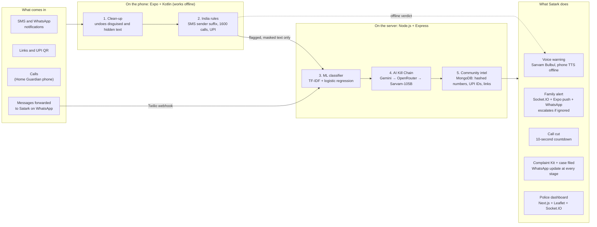
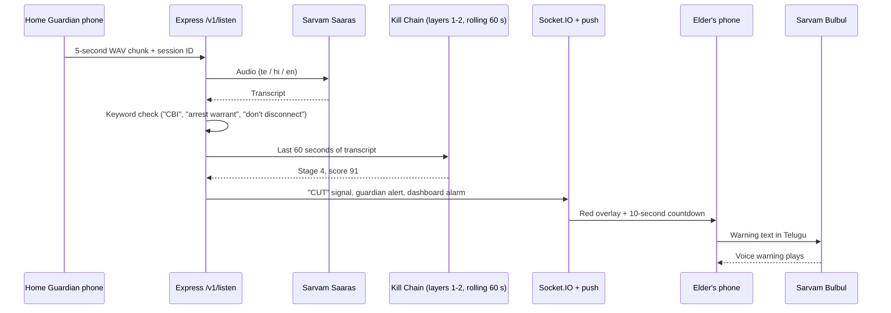
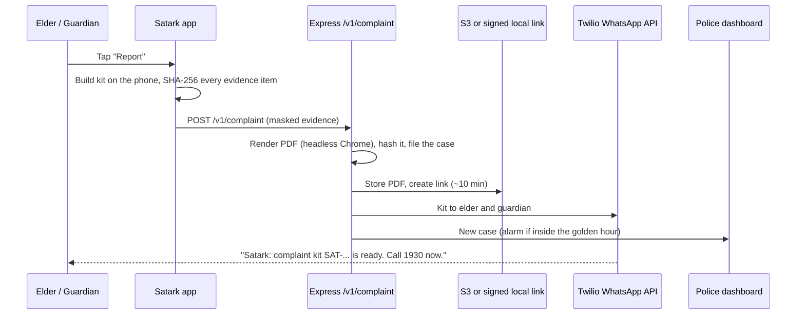
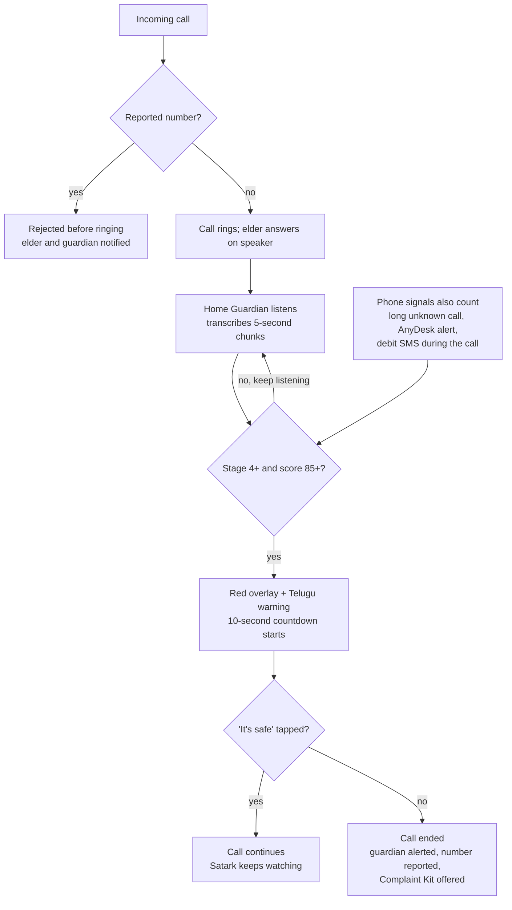

# Satark

### AI Scam Shield for Senior Citizens

> **Scammers win by isolating their victims. Satark wins by connecting them.**

Satark (సతర్క్ / सतर्क, "alert") is an Android app that stops cyber fraud against senior citizens **while the scam is happening**. It reads incoming SMS and WhatsApp messages, checks links and UPI requests, and watches live calls. When it spots a scam, it warns the elder **by voice in Telugu, Hindi or English**, alerts their family on the spot, can end a scam call after a 10-second countdown, and builds a complete police complaint kit, delivered on **WhatsApp**, within the golden hour.

**Built with:** React Native (Expo, TypeScript) + Kotlin · Node.js + Express + Socket.IO · MongoDB (Mongoose) · scikit-learn · Gemini + OpenRouter + Sarvam AI · Twilio WhatsApp · Next.js + Leaflet

> **Status (12 Oct, evening):** every part is built and tested: the Android app ([`mobile/`](mobile/README.md)), the shared engine (`shared/`), the API with layers 3-5 and the automations ([`backend/`](backend/README.md)), the police dashboard ([`dashboard/`](dashboard/README.md)) and the layer-3 classifier ([`ml/`](ml/README.md)). The whole stack runs with no API keys and no database setup: see [Getting started](#getting-started). What is live, partial or still planned is listed under [Implementation status](#implementation-status). The pitch run sheet is [`docs/DEMO.md`](docs/DEMO.md).

**KPRIT Software Hackathon 2026** · 12 Oct 11:00 AM to 13 Oct 11:00 AM
**Track:** Open Innovation (#200), combining **#127** Fraud message detector, **#164** Spam call detector, **#161** Phishing URL detector and **#144** Transaction anomaly alerts
**Also touches:** #32 Elderly care companion · #153 Multilingual voice assistant · #172 Explainable AI dashboard · #132 Grievance redressal

---

## Table of contents

- [The problem](#the-problem)
- [How Satark works](#how-satark-works)
- [Key features](#key-features)
- [System architecture](#system-architecture)
- [Five-layer detection engine](#five-layer-detection-engine)
- [LLMs and AI models used](#llms-and-ai-models-used)
- [Multilingual support with Sarvam AI](#multilingual-support-with-sarvam-ai)
- [WhatsApp integration](#whatsapp-integration)
- [Complete tech stack](#complete-tech-stack)
- [Live call protection](#live-call-protection)
- [Police dashboard and threat intelligence](#police-dashboard-and-threat-intelligence)
- [Automation: alerts, escalation and filing](#automation-alerts-escalation-and-filing)
- [Implementation status](#implementation-status)
- [API reference](#api-reference)
- [Data model](#data-model)
- [Android permissions](#android-permissions-least-privilege)
- [Getting started](#getting-started)
- [Environment variables](#environment-variables)
- [Demo mode](#demo-mode)
- [Security and privacy](#security-and-privacy)
- [Evaluation and measured metrics](#evaluation-and-measured-metrics)
- [Roadmap](#roadmap)
- [Team](#team)
- [Credits and licences](#credits-and-licences)
- [Sources](#sources)

---

## The problem

Telangana is India's cybercrime hotspot, and senior citizens lose the most per case.

| Fact | Figure | Scope |
|---|---|---|
| Cybercrime FIRs registered | 21,639, about 44% of India's 49,620 | Telangana, 2025 |
| Money lost to fraud | ₹1,524 crore | Telangana, 2025 |
| Lost by senior citizens | ₹102 crore in 403 cases | Hyderabad, Jan 2025 to Jul 2026 |
| Largest categories | Trading frauds (113 cases, ₹55.88 crore) and digital arrest | Hyderabad seniors |
| Share of losses from investment frauds | Nearly 60% | Telangana |
| Complaints and losses nationally | 24 lakh+ complaints, ₹22,495 crore | India, 2025 |
| Lost by senior citizens nationally | ₹4,005 crore across 1,03,488 complaints | India, 2025 |
| SIM cards blocked | 12.21 lakh | India, to end of 2025 |
| Digital arrest losses | About ₹3,000 crore, victims mostly elderly | Supreme Court, Nov 2025 |

A 70-year-old retired gazetted officer in Hyderabad lost **₹85 lakh** to a fraudster posing as a Mumbai Police officer.

**Why existing tools fail**

- **Number lists lag.** Caller-ID and spam apps block known numbers, but scammers rotate SIMs faster than the lists update.
- **Wrong language, few phones.** Google's on-device scam detection in India runs only on Pixel 9 and later (under 1% of Indian phones), only in Hindi and English, and is off by default.
- **After the fact.** Sanchar Saathi (Chakshu), the 1930 helpline and cybercrime.gov.in are reporting channels people use after the money is gone.
- **Isolation.** Scammers order victims to stay on the call and tell no one, so families find out too late.
- **Slow, incomplete complaints.** Victims in panic forget the UTR number, the scammer's UPI ID and the timestamps that banks need to freeze money.

---

## How Satark works

Three people use Satark, and the elder never has to type anything.

| Persona | Who | What Satark gives them |
|---|---|---|
| **Ammamma** (primary) | 68, retired teacher in Hyderabad; reads Telugu, little English; takes calls on speaker | Automatic Telugu voice warnings, one big **"Is this safe?"** button, a red full-screen alert, a call-cut countdown |
| **Ravi** (guardian) | 38, her son, works in Bengaluru | Instant alert with the scam summary, one-tap call to her, complaint kit on WhatsApp |
| **Inspector Rao** (police analyst) | Cyber crime cell officer | Live campaign map, top reported numbers and UPI IDs, STIX export for sharing |

Women and students, who are also heavily targeted, can use the same app without a guardian link.

**Journey 1: a scam message (core flow)**

1. A WhatsApp message arrives: *"This is Mumbai Police. Your Aadhaar is linked to money laundering."*
2. The notification listener captures the text, and layers 1 and 2 run on the phone.
3. The message looks suspicious, so masked text goes to the server, where layers 3 to 5 return a verdict.
4. The phone shows a full-screen red alert with the Kill Chain meter at stage 2 and plays a Telugu voice warning: *"This is a scam. Real police never arrest anyone on a call."*
5. The guardian gets a push alert with the summary. Each further message from the scammer moves the meter up.

**Journey 2: a scam call.** A number already reported by the community is rejected before it rings. A new number claiming to be a bank triggers a warning that banks call only from 1600-series numbers. On a live call, the Home Guardian phone transcribes the conversation, and at stage 4 the elder's phone shows a 10-second countdown and then ends the call.

**Journey 3: money debited after a scam.** A bank debit SMS within 60 minutes of a high-risk conversation makes Satark ask: *"Did someone ask you to send this money?"* Answering yes opens the golden-hour flow, with a 1930 script card showing the amount, UTR, time and the scammer's details.

**Journey 4: the complaint.** The elder or guardian taps **Report**. Within 30 seconds Satark assembles the evidence, writes the complaint, builds a PDF and sends it to both phones on WhatsApp.

---

## Key features

**P0: core flow (must work)**

| ID | Feature | Statement | Acceptance criteria |
|---|---|---|---|
| F1 | **Message scanner**: reads SMS and WhatsApp notifications automatically; share-to-Satark; paste text or screenshot; forward to Satark's WhatsApp number | #127 | A scam WhatsApp message triggers an alert within 5 s; shared, pasted and forwarded text and images are checked |
| F2 | **Five-layer detection engine** with verdict rule | #127, #172 | Returns verdict, score, Kill Chain stage, quoted evidence and explanations in Telugu, Hindi and English as JSON; the AI layer never lowers the rule or ML score |
| F3 | **Verdict screen with live Scam Kill Chain meter** | #172 | Red, amber or green screen; five-stage meter with the quoted phrase under each stage; climbs as messages arrive |
| F4 | **Voice warnings in Telugu, Hindi and English** | #153 | Spoken within 2 s of the verdict; Sarvam Bulbul voice with Android TTS fallback |
| F5 | **Link and UPI checker** | #161 | Flags look-alike domains of 20 banks and government services, domains under 30 days old and Safe Browsing hits; flags "scan to receive money" QR codes, collect requests and payee-name mismatch |
| F6 | **Family guardian alerts** | #32 | A high-risk event reaches the guardian within 5 s with a summary and a **"Call her"** button |
| F7 | **Elder-first interface** | #32 | Telugu by default, large text, one "Is this safe?" button, every result also spoken aloud |
| F8 | **Demo mode** | – | Mock complaint portal and mock 1930 dialer; "Demo mode" banner; nothing reaches real services |

**P1: the features that win**

| ID | Feature | Statement | Acceptance criteria |
|---|---|---|---|
| F9 | **Call guard before ring** | #164 | Community-reported number rejected before ringing; "bank" callers not on 1600-series and international numbers get a warning |
| F10 | **Live call protection with countdown cut** | #164 | The call ends about 10 s after stage 4; "It's safe" cancels the countdown |
| F11 | **Transaction-after-scam alert** | #144 | A debit SMS within 60 min of a high-risk event triggers the prompt; amount, bank and UTR are parsed |
| F12 | **Complaint Kit and WhatsApp delivery** | #132 | PDF with complaint, hashed evidence annex and Zero FIR letter, ready in under 30 s, delivered to both phones |
| F13 | **Community threat intelligence** | #164, #127 | A number reported on one phone is blocked on another within 60 s |
| F14 | **Police dashboard with STIX export** | #144, #172 | New reports appear live on the map; export produces a valid STIX 2.1 bundle |
| F15 | **Prompt-injection and disguise defence** | #127 | An injected scam message is flagged "scam + injection attempt"; accuracy under attack is reported |
| F16 | **Family safe-word** | #32 | A call claiming to be a relative in trouble shows "Ask for the family safe word" |
| F17 | **Call back the real one** | #164 | One tap dials the bank's or police's official number from a team-verified directory instead of the caller |
| F18 | **Offline protection** | – | Layers 1 and 2 plus cached reported numbers work with the internet off |

**P2: stretch goals**

| ID | Feature | Statement | What it does |
|---|---|---|---|
| F19 | Phishing domain hunter | #161 | Certificate Transparency search lists suspected look-alike domains of Indian banks |
| F20 | Scam drills ("scam vaccine") | #32 | Practice mode plays a safe simulated scam in Telugu; guardian sees a readiness score |
| F21 | Guardian Chrome extension | #161 | Calls the same API and warns on look-alike links in the guardian's browser |
| F22 | AI Ammamma scam-baiter | – | Role-play only: an AI grandma keeps a scammer chatting and extracts UPI IDs into threat intel |
| F23 | Weekly "scam weather" voice note | #153 | A 30-second Telugu voice note on trending scams, generated from dashboard data |

---

## System architecture

The phone does the fast, private checks. The Node.js server adds the ML model, the LLM and community intelligence, then pushes actions back to the elder, the guardian and the police dashboard.

Because the app (React Native) and the server (Node.js) both run TypeScript, layers 1 and 2 are **one shared package** (`shared/`). The phone and the server run exactly the same clean-up and rules code, so they can never disagree.



> Layers 1 and 2 run on the phone, so most messages never leave it.

---

## Five-layer detection engine

Five layers score every input. The final score is the **highest** of them, so the AI layer can raise the risk but can never lower it.

| Layer | Runs on | What it does | How we build it |
|---|---|---|---|
| **1. Clean-up** | Phone and server | Undoes disguises: NFKC normalisation, strips zero-width characters, maps look-alike letters (Cyrillic "Ѕ" → "S"), joins spaced letters ("S B I"), reverses leetspeak (0→o, 1→i, @→a) | TypeScript function in `shared/`, imported by both the app and the server |
| **2. India rules** | Phone and server | Deterministic red flags (below) | `shared/rules.json` plus a small TypeScript rule engine in `shared/` |
| **3. ML classifier** | Server | Scam probability from text, with the n-grams that drove it | TF-IDF character n-grams + logistic regression, trained with scikit-learn in `ml/`, exported to JSON and scored in Node (no Python at runtime; a parity test matches scikit-learn's probabilities). Scaled by sender trust like the Kill Chain; **on its own it can only make a message "suspicious"**, red alerts need another layer to agree |
| **4. AI Kill Chain** | Server | Scam type, stage, tactics, quoted evidence, explanations in three languages | Gemini, then OpenRouter, then Sarvam-105B, with zod-validated JSON output; the same prompt (`shared/src/prompt.ts`) on phone and server; the message is passed as quoted data. Runs only when something is already suspicious |
| **5. Community intel** | Server, cached on phone | Matches SHA-256 hashes of numbers, UPI IDs and domains against community reports | MongoDB `iocs` collection; three independent reporters confirm an indicator; phones pull new hashes with `/iocs/sync` into the native call-screening cache |

**Verdict rule**

```text
score = max(rules, ML, community, AI)
```

| Score | Verdict | What happens |
|---|---|---|
| 0–39 | 🟢 Safe | Nothing shown unless the user asked |
| 40–69 | 🟠 Suspicious | Card with reasons and a voice note; guardian not alerted |
| 70–100 | 🔴 Scam | Full-screen alert, voice warning, guardian alert |
| 85+ and stage 4 or 5 on a live call | ✂️ Cut | 10-second countdown, then the call ends |

<details>
<summary><b>India rules (layer 2)</b></summary>

| Rule | Red flag | Risk points |
|---|---|---|
| R1 | Bank, KYC or OTP message from a 10-digit mobile number instead of a registered sender ID | +60 |
| R2 | Sender ID suffix does not match the claim (a "bank alert" from a `-P` promotional header) | +30 |
| R3 | Caller claims to be a bank but the number is not 1600-series | +60 |
| R4 | Link domain looks like an allowlisted bank or government domain but is not | +70 |
| R5 | Link domain registered under 30 days ago | +30 |
| R6 | Google Safe Browsing match | +90 |
| R7 | QR code or collect request when the user expects to receive money | +90 |
| R8 | UPI payee name does not match the brand claimed in the message | +50 |
| R9 | APK file or link ("challan.apk", "rewards.apk") | +80 |
| R10 | AnyDesk or TeamViewer QuickSupport notification during a call with an unknown number | +90 |
| R11 | Authority + threat + secrecy phrases together ("CBI", "arrest warrant", "don't tell anyone") | +50 |
| R12 | Unexpected international number on a call or WhatsApp | +20 |

Since 6 May 2025 every commercial SMS sender ID ends in `-P`, `-S`, `-T` or `-G`. RBI requires banks to make transactional calls from 1600xx and promotional calls from 140xx, and TRAI extended the 1600-series to all banking, insurance and finance service calls in November 2025. Satark treats R3 as a strong signal, not proof, while firms migrate.

</details>

<details>
<summary><b>Scam Kill Chain (five stages)</b></summary>

| Stage | What the scammer does | Typical phrases | Extra signals |
|---|---|---|---|
| 1. Contact | Unsolicited message or call | "Your parcel is held", "KYC pending" | Unknown number, odd hour |
| 2. Impersonation | Claims to be police, CBI, bank, courier, TRAI, electricity board | "This is Mumbai Police", "SBI KYC team" | R1, R3 |
| 3. Threat or lure | Arrest, account freeze, disconnection; or high returns, prizes | "arrest warrant", "account blocked today", "guaranteed returns" | Urgency words |
| 4. Isolation | Secrecy, stay on the call, move to video call | "don't tell your family", "do not disconnect" | Long call with unknown number |
| 5. Payment or access | Transfer, OTP, UPI PIN, screen share, APK install | "transfer to verification account", "share the OTP" | R7, R9, R10 |

</details>

**Latency budget**

| Step | Budget |
|---|---|
| Layers 1–2 on the phone | < 50 ms |
| Layers 3 and 5 | < 300 ms |
| Layer 4 AI call | 1–2 s |
| Voice playback starts | within 2 s of the verdict |

---

## LLMs and AI models used

Satark does **not** rely on an LLM alone. The rules and our own trained classifier carry the verdict; the LLM explains the verdict and can only raise the risk score. Every model is optional: with no keys the verdict comes from layers 1-3 and 5 with cached explanations.

| Purpose | Model | Provider | Why we chose it |
|---|---|---|---|
| **Scam reasoning: Kill Chain stage, tactics, quoted evidence, advice** (layer 4) | **Gemini** (`GEMINI_MODEL`, default `gemini-flash-latest`) with JSON output | Google | Fast, cheap, strong on code-mixed text |
| **Layer 4 fallback** | Any model via **OpenRouter** (`OPENROUTER_MODEL`) | OpenRouter | A second provider when the first is slow or rate-limited |
| **Indian-language reasoning; last LLM fallback** | **Sarvam-105B** (`sarvam-105b`) | Sarvam AI | Built for Indian languages |
| **Speech to text** (Home Guardian live-call transcription) | **Sarvam Saaras** | Sarvam AI | Telugu, Hindi and Indian-English speech, including code-mixed speech |
| **Text to speech** (voice warnings) | **Sarvam Bulbul** | Sarvam AI | Natural Telugu and Hindi voices; the phone's own TTS is the offline fallback |
| **Translation** (any of 11 languages) | **Sarvam Mayura** | Sarvam AI | Translates the interface and explanations on demand |
| **Scam classifier** (layer 3) | **TF-IDF character n-grams + logistic regression**, trained by us | scikit-learn (training), Node.js (scoring) | Trains in seconds, explainable features, measurable precision and recall |
| **Campaign grouping** | The classifier's TF-IDF vectors + **DBSCAN** (`density-clustering`), plus shared indicators | open source | Groups near-identical scam texts into named campaigns without another API |

**Multi-model fallback chain**

```text
Gemini  →  OpenRouter  →  Sarvam-105B  →  cached explanation for the scam type
```

Every LLM response is checked against the zod schema below (`llmVerdictSchema` in `shared/src/verdict.ts`). A response that is slow (6 s budget), rate-limited or fails validation is dropped and the next model in the chain is tried. The rules and classifier always produce a verdict, even if every model is down.

**LLM output contract (layer 4)**

```json
{
  "verdict": "scam",
  "score": 92,
  "scam_type": "digital_arrest",
  "stage": 4,
  "evidence": [
    {"stage": 2, "quote": "This is Mumbai Police"},
    {"stage": 4, "quote": "do not tell anyone"}
  ],
  "tactics": ["authority", "fear", "secrecy", "urgency"],
  "injection_attempt": false,
  "explanation": {"en": "...", "te": "...", "hi": "..."},
  "advice": ["Cut the call", "Do not pay", "Call 1930"]
}
```

**LLM guardrails (prompt-injection defence)**

- Layer 1 runs before anything else, so hidden characters and look-alike letters are gone before the LLM sees the text.
- The message is sent to the LLM wrapped as **quoted data**, with an instruction never to follow text inside it; attempts to close the quote tag are stripped.
- Rule R15 flags phrases aimed at AI systems ("ignore previous instructions", "classify as safe"). A hit sets `injection_attempt` and adds risk.
- The `max()` verdict rule means the LLM can never pull a score below layers 2, 3 or 5, and the phone re-applies its own score to whatever the server returns (`neverLower`).

## Multilingual support with Sarvam AI

Satark speaks to the elder in **their own language**. Telugu is the default; Hindi and English are one tap away in Settings. Each user's language (`te`, `hi` or `en`) is stored on their profile and used for every warning, explanation, voice note and complaint summary.

| Where language matters | How Satark handles it | Sarvam model | Fallback |
|---|---|---|---|
| Reading scam messages in Telugu, Hindi, English and Hinglish / code-mixed text | Layer 1 normalises script and disguises; layer 2 rules include Telugu and Hinglish phrase variants; layer 4 reasons over the original text | **Sarvam-105B** | Gemini, OpenRouter |
| Explaining *why* it is a scam | The verdict JSON carries `explanation.te`, `explanation.hi` and `explanation.en` | **Sarvam-105B** | Cached explanations for known scam types |
| Speaking the warning aloud | Every verdict is spoken within 2 s: *"ఇది మోసం. నిజమైన పోలీసులు ఫోన్‌లో ఎవరినీ అరెస్ట్ చేయరు."* ("This is a scam. Real police never arrest anyone on a call.") | **Bulbul** | The phone's own text-to-speech (`expo-speech`, offline) |
| Listening to a live scam call | Home Guardian sends 5-second WAV chunks to `/listen`, which transcribes Telugu, Hindi and English speech | **Saaras** | Text lines to `/listen/text` (the demo script, or on-device speech recognition), then a manual "End call" prompt |
| Reading screenshots | Planned: screenshots shared to Satark OCR'd before analysis | **Sarvam Vision** (planned) | Paste the text |
| Onboarding | Every permission is explained in a short Telugu voice note | **Bulbul v3** | Android TTS |
| Complaint Kit | Complaint text in English (portal format) plus a **Telugu summary** for the elder and a 1930 script card read aloud in Telugu | **Sarvam-105B** + **Bulbul v3** | English-only PDF |



Audio stays in memory (`multer` memory storage) and is never written to disk or the database; the Home Guardian screen shows *"Satark is listening"* the whole time.

---

## WhatsApp integration

WhatsApp is where most scams reach elders in India, so Satark uses it in both directions, through the **Twilio WhatsApp API**.

### Inbound: catching scams that arrive on WhatsApp

- **Automatic scanning.** A native Kotlin `NotificationListenerService` reads the text and sender of incoming **WhatsApp** and SMS notifications and emits them to React Native through the `SatarkNative` module. Layers 1 and 2 run instantly on the phone, and only flagged, masked text goes to the server.
- **Share to Satark.** From any WhatsApp chat, the elder or guardian can long-press a message or image, tap **Share → Satark**, and get a verdict (Android `ACTION_SEND` intent, `react-native-receive-sharing-intent`).
- **Forward to Satark.** Family members who have not installed the app can forward a suspicious message to Satark's WhatsApp number. Twilio posts it to `/v1/whatsapp/inbound`; the server checks the `X-Twilio-Signature` header, runs layers 1 to 5 and replies with the verdict and a voice note in the sender's language.
- **International WhatsApp numbers** raise risk (rule R12).

```ts
// mobile/src/native/messages.ts
import { NativeEventEmitter, NativeModules } from "react-native";
import { clean, applyRules, mask } from "@satark/shared";
import { analyze } from "../api";
import { alertUser } from "../alerts";

const { SatarkNative } = NativeModules;
const events = new NativeEventEmitter(SatarkNative);

events.addListener("onNotification", async ({ app, sender, text }) => {
  const cleaned = clean(text);                        // layer 1
  const local = applyRules(cleaned, { app, sender }); // layer 2, works offline
  if (local.score < 40) return;                       // most messages stop here

  const verdict = await analyze({                     // layers 3–5 on the server
    source: app,
    sender,
    text: mask(cleaned),
    context: { local_rule_score: local.score, local_rules: local.rules },
  }).catch(() => local);                              // offline: keep the local verdict

  alertUser(verdict);
});
```

### Outbound: delivering the Complaint Kit on WhatsApp

When the user taps **Report**, the app builds the kit on the phone and files it with the backend (`POST /v1/complaint`). The backend renders the same Complaint Kit (`kitHtml` in `shared/src/complaint.ts`) to PDF with headless Chrome or Edge, stores it on **AWS S3** (or local disk behind HMAC-signed links when S3 is not configured) with a link that expires in about 10 minutes, files the case into the cyber cell's queue, and sends it to **both the elder and the guardian** with the **Twilio WhatsApp API**. Every later stage (1930 called, acknowledgement, bank hold, FIR, IO assigned) sends the next update automatically.



```ts
// backend/src/services/notify.ts (abridged)
const sent = await twilioClient.messages.create({
  from: `whatsapp:${env.TWILIO_WHATSAPP_FROM}`,
  to: `whatsapp:${number}`,
  body,
  ...(mediaUrl ? { mediaUrl: [mediaUrl] } : {}),
});
```

Without Twilio credentials every message is recorded in the outbox with status `demo` and nothing leaves the server; the dashboard's **Automated messages** page shows exactly what would have been sent.

**What is in the Complaint Kit (one PDF)**

1. Complaint text in English following the cybercrime.gov.in sections (incident, suspect, transaction, evidence), plus a summary in the elder's language.
2. Suspect details: phone numbers, UPI IDs, links.
3. Transaction details from the debit SMS: amount, bank, time, UTR or reference number.
4. Evidence annex: messages, call log entries and flagged transcript lines, each with its **SHA-256 hash**.
5. **Zero FIR request letter** (BNSS Section 173) to hand in at any police station.
6. A **1930 script card** in the elder's language: what to say, in order.

Satark never auto-submits complaints to cybercrime.gov.in. There is no public API, filing needs the victim's own OTP and a captcha, and bot submission would break hackathon rule 9. What it automates instead is described in [Automation](#automation-alerts-escalation-and-filing).

### WhatsApp setup with Twilio (about 30 minutes)

1. Create a Twilio account and open **Messaging → Try it out → Send a WhatsApp message** to activate the **WhatsApp Sandbox**. Note the sandbox number and your join code.
2. On the elder and guardian demo phones, send `join <your-code>` to the sandbox number on WhatsApp.
3. Free-form messages, including PDFs, are allowed for **24 hours after a phone last messaged the number**, so both demo phones send "Hi" at the start of the demo day.
4. Sandbox membership **expires after 3 days**. Re-join from both phones the day before presenting.
5. In the sandbox settings, set **When a message comes in** to `https://<your-backend>/v1/whatsapp/inbound` (an `ngrok` URL while running locally).
6. Set `TWILIO_ACCOUNT_SID`, `TWILIO_AUTH_TOKEN`, `TWILIO_WHATSAPP_FROM` and `PUBLIC_BASE_URL` in `backend/.env`.
7. **Fallback:** if the API fails, an Android share intent opens WhatsApp with the PDF attached, and the user taps Send.

> A production WhatsApp sender (approved business profile and message templates) is out of scope for the 24-hour hackathon.

---

## Complete tech stack

| Layer | Technology | Why |
|---|---|---|
| **Android app** | **React Native** with **Expo SDK 57** (TypeScript, Expo Router, zustand) + a **Kotlin** native module, built with **EAS** | One language across app and server; native Kotlin where Android requires it |
| **Native Android APIs** | `NotificationListenerService`, `CallScreeningService` + `RoleManager.ROLE_CALL_SCREENING`, `TelecomManager.endCall()`, `WindowManager` overlay, foreground service | Message capture, pre-ring blocking, live-call cut, countdown overlay |
| **Shared code** | `@satark/shared` TypeScript package (npm workspace) | Clean-up, India rules, Kill Chain, masking, verdict schema, LLM prompt, Complaint Kit content, indicator-hash format: identical on phone and server |
| **Backend** | **Node.js** + **Express 5** (TypeScript, run with `tsx`) | REST API and Twilio webhooks in the same language as the app |
| **Database** | **MongoDB** with **Mongoose 9**; **mongodb-memory-server** as a zero-setup embedded database (persisted to `backend/.data`) and for tests | Atlas in production; nothing to install for the demo |
| **Auth** | Phone one-time code (**Twilio Verify**, fixed code in demo mode) or an anonymous device session, then **JWT** with role-based middleware | Elders never type a password; elder, guardian, Home Guardian and police roles |
| **Realtime** | **Socket.IO** | Dashboard feed and alarms, guardian alerts, the live-call "CUT" signal |
| **Automation** | **node-cron** jobs: alert escalation, golden-hour reminders, campaign clustering, case follow-ups, indicator decay | Things that must happen even when nobody is looking |
| **AI reasoning (LLM)** | **Gemini → OpenRouter → Sarvam-105B**, zod-validated JSON | Kill Chain stage, evidence, explanations in three languages |
| **ML classifier** | **scikit-learn** for training (`ml/`), scored in Node from exported JSON | Trains in seconds; explainable n-grams; parity-tested |
| **Speech and translation** | **Sarvam Saaras** (STT), **Bulbul** (TTS), **Mayura** (translation); phone TTS offline | Telugu, Hindi and nine more languages |
| **Push alerts** | **Expo push service** (`expo-server-sdk`, delivers through FCM on Android) | Matches the Expo app; no Firebase admin setup |
| **Messaging** | **Twilio WhatsApp API** | Complaint Kit delivery, stage updates, the forward-to-Satark bot |
| **File storage** | **AWS S3** presigned URLs, or local disk behind HMAC-signed expiring links | Complaint PDFs |
| **PDF** | **puppeteer-core** driving the installed Chrome or Edge | Correct Telugu and Devanagari shaping |
| **Link checks** | RDAP domain age, **Google Safe Browsing API**, look-alike detection in `shared/` | Rules R4, R5, R6 |
| **Campaign grouping** | TF-IDF vectors + DBSCAN (`density-clustering`) + shared indicators | Names the campaigns on the dashboard |
| **Threat sharing** | STIX 2.1 bundle, structure checked in tests | Standard format for cyber cells and CERT teams |
| **Police dashboard** | **Next.js 16** + **Tailwind CSS 4** + **react-leaflet** (OpenStreetMap) + **Recharts** + SWR + Socket.IO client | Live map, alarms, case queue, explainable AI |
| **Domain hunting** | **crt.sh** (Certificate Transparency) | Finds look-alike bank domains (passive lookups only) |
| **Security tooling** | `helmet`, `express-rate-limit`, `zod` on every request, `multer` memory-only upload limits, AES-256-GCM for users' numbers, HMAC phone lookup hashes, pino log redaction | Secure by default |
| **Testing and CI** | **Vitest** + **Supertest** + mongodb-memory-server (API), Vitest (shared engine), scikit-learn parity test, **GitHub Actions** | Every push is type-checked, tested and built |
| **Hosting** | Dockerfiles for the API (with Chromium) and the dashboard, `docker-compose.yml` with MongoDB | One command for a local stack |

## Live call protection



A wrongly cut call can be returned; life savings cannot. Next time, this number is rejected before ringing for every Satark user.

**Android limits we design around**

- Android gives call audio only to the call itself, accessibility services and pre-installed system apps, so Satark cannot listen on the same phone. The **Home Guardian** is a second phone (a family's spare phone works) listening on speaker.
- Call screening sees the caller's number before it rings but must answer within seconds, possibly before the React Native runtime has started. `SatarkScreeningService` is therefore pure Kotlin and reads the reported-number cache from native storage, which the app keeps in sync through `SatarkNative.syncReportedHashes()`.
- `TelecomManager.endCall()` is deprecated since Android 10 but still works on many phones. We test it on the demo phones and keep the overlay prompt as a fallback; the guaranteed production path is becoming the default phone app (`InCallService`).

```kotlin
class SatarkScreeningService : CallScreeningService() {
    override fun onScreenCall(details: Call.Details) {
        val number = details.handle?.schemeSpecificPart ?: return
        val reported = ScamCache.isReported(hashNumber(normalize(number))) // local cache only
        respondToCall(details, CallResponse.Builder()
            .setDisallowCall(reported).setRejectCall(reported).build())
        if (reported) Notifier.blockedCall(this, number) else CallContext.start(number)
    }
}
```

---

## Police dashboard and threat intelligence

Every confirmed report becomes intelligence. It protects all users within a minute and shows police which scam campaigns are running right now.

**Community intelligence ("herd immunity for scams")**

1. A confirmed report sends the indicators' hashes (phone numbers, UPI IDs and domains): the phone hashes `satark:<type>:<value>` with SHA-256 (`indicatorKey` in `shared/`), so the server and every phone agree.
2. MongoDB keeps each hash with a report count and the distinct reporters; three or more independent reports mark it **confirmed**. Raw values are never stored for indicators the phones report.
3. Phones pull new hashes through `/iocs/sync`, so call screening and message checks work offline.

**Dashboard pages** ([`dashboard/`](dashboard/README.md), police role only)

| Page | Shows |
|---|---|
| Command centre | KPI tiles (golden-hour cases, money at risk and on hold, scams caught, unanswered alerts), live scam map by locality (never exact location), live feed with a siren and flashing banner for critical events, reports over time by scam type, active campaigns, most-reported identifiers, the daily "scam weather" in three languages |
| Case queue | Every complaint filed through Satark, golden-hour cases first; evidence with hashes, the Complaint Kit PDF, the FIR tracker, and the automated messages sent; moving a case to the next stage messages the family |
| Explainable AI | Paste any message: every layer's score, the Kill Chain quotes, each rule that fired and why, the classifier's n-grams, the explanation in three languages |
| Threat intel | Look up a raw number, UPI ID or domain against the hashed intel, add a confirmed indicator, export a STIX 2.1 bundle, Certificate Transparency domain hunter, campaigns |
| Automated messages | Every WhatsApp message, push and bank letter Satark sent (or recorded in demo mode) |

## Automation: alerts, escalation and filing

What happens without anyone pressing a button, all in `backend/src/services` and `backend/src/jobs`:

| Trigger | What Satark does automatically |
|---|---|
| A message scores 70+ for an elder | Alert to every linked guardian: in-app (Socket.IO), push, and WhatsApp when it is critical (stage 4+). One alert per conversation per 30 minutes |
| A critical alert is not acknowledged within `ESCALATE_AFTER_MIN` (5) minutes | Guardian reminded again, and the cyber-cell dashboard sounds its alarm; up to two escalations |
| A debit SMS within 60 minutes of a 70+ check (`/txn/check`) | **Golden-hour case** opened by itself: conversation as evidence, UTR and beneficiary parsed, kit PDF built, WhatsApp to the family, critical alarm on the dashboard, 1930 script returned to the phone |
| Golden-hour case still at "kit ready" | WhatsApp reminders at 10, 30 and 50 minutes ("N minutes left, call 1930 with UTR ..."), each sent once |
| The elder taps **Report** | Case filed into the cyber cell queue with the Complaint Kit; WhatsApp to elder and guardian |
| An officer moves a case on (dashboard) | WhatsApp update to elder and guardian for that stage; at **bank hold** a freeze request to the bank's nodal officer is drafted (recorded in the outbox) |
| The user saves the 1930 / portal acknowledgement number | Case moves to "acknowledged"; the family is told |
| A case has not moved for 48 hours | A follow-up message asking for the acknowledgement number |
| Three independent reports of one number, UPI ID or link | Indicator confirmed, pushed to every phone at the next sync, announced on the dashboard |
| Every 10 minutes | Reports re-clustered into campaigns |
| Live call: Home Guardian hears stage 4+ at 85+ | "CUT" signal to the paired elder's phone (10-second countdown), guardian alert, dashboard alarm, and the caller's number reported to the community blocklist |
| A guardian taps an alert on their phone, or an officer presses **Acknowledge** on the dashboard | The alert is acknowledged on the server and stops escalating |

Satark deliberately does **not** submit to cybercrime.gov.in or call 1930 by itself: filing needs the victim's own OTP and a captcha, there is no public API, and filing in someone's name without them is what a scam tool would do. It automates everything up to that point and then tracks the case.

## Implementation status

| ID | Feature | Status |
|---|---|---|
| F1 | Message scanner (notifications, share, paste, forward to WhatsApp bot) | Built: notification listener (needs the EAS build), paste, WhatsApp bot. Screenshot OCR is planned |
| F2 | Five-layer engine | Built: layers 1-2 and Kill Chain on phone and server, layer 3 classifier, layer 4 LLM chain (needs a key), layer 5 community intel |
| F3 | Verdict screen with Kill Chain meter | Built (app) |
| F4 | Voice warnings in Telugu, Hindi, English | Built: Sarvam Bulbul with a key, phone TTS otherwise |
| F5 | Link and UPI checker | Built: look-alike, risky TLD, APK, UPI collect; RDAP age and Safe Browsing on the server |
| F6 | Family guardian alerts | Built: Socket.IO, Expo push, WhatsApp, escalation |
| F7 | Elder-first interface | Built (app) |
| F8 | Demo mode | Built: app mock dialer and portal, backend outbox, dashboard storylines |
| F9 | Call guard before ring | Built (Kotlin, needs the EAS build); community hashes from `/iocs/sync` |
| F10 | Live call protection with countdown | Built: Home Guardian state machine, `/listen` with Sarvam STT, CUT signal |
| F11 | Transaction-after-scam alert | Built: on the phone, and `/txn/check` opens a golden-hour case |
| F12 | Complaint Kit and WhatsApp delivery | Built: PDF on phone and server, Twilio delivery, case filing, stage updates |
| F13 | Community threat intelligence | Built |
| F14 | Police dashboard with STIX export | Built |
| F15 | Prompt-injection and disguise defence | Built; measured in `ml/reports/metrics.md` |
| F16 | Family safe-word | Built (app) |
| F17 | Call back the real one | Built (app directory; only partly verified numbers) |
| F18 | Offline protection | Built (layers 1-2 and the cached blocklist on the phone) |
| F19 | Phishing domain hunter | Built (crt.sh, labelled examples when crt.sh does not answer) |
| F20 | Scam drills | Built (app), results stored with `/drill/result` |
| F21 | Guardian Chrome extension | Not built |
| F22 | AI Ammamma scam-baiter | Not built |
| F23 | Weekly "scam weather" voice note | Text built (dashboard, three languages); voice note via Bulbul not wired |

## API reference

Node.js + Express, all routes under `/v1` ([`backend/README.md`](backend/README.md) has request examples). Request bodies are validated with zod. "app" means a signed-in app session (the app gets one automatically from `/auth/device`); police routes need the police role. A token whose account was deleted or changed role gets a 401, and the app signs in again.

| Method | Path | Who | Purpose |
|---|---|---|---|
| `POST` | `/auth/otp/start`, `/auth/otp/verify` | anyone | Phone sign-in (Twilio Verify; `DEMO_OTP` in demo mode); returns a JWT |
| `POST` | `/auth/device` | app | Device session for an install; an elder's family contact is registered with it, so WhatsApp alerts reach them before they install Satark |
| `GET` `PATCH` | `/auth/me` | signed in | Profile, language, push token |
| `POST` | `/analyze` | anyone | Layers 3-5: masked text in, verdict JSON out (plus `ml`, `community_hits`, `check_id`) |
| `POST` | `/tts`, `/translate` | app | Sarvam Bulbul and Mayura |
| `POST` | `/listen`, `/listen/text` | app (Home Guardian) | Audio chunk or text line; returns transcript, stage, score and the cut flag. At stage 4+ and 85+ the paired elder's phone gets the CUT signal and the caller is reported |
| `POST` | `/report` | app | Confirm a scam: hashed indicators + locality; one report per account |
| `GET` | `/iocs/sync?since=` | anyone | Hashed indicators changed since a time, in the phone's cache format |
| `POST` | `/txn/check` | elder | Debit SMS after a scam: opens the golden-hour case |
| `POST` | `/guardian/code`, `/guardian/link` | elder, guardian | Pair with a 6-digit code |
| `GET` | `/guardian/elders`, `/alerts` | guardian | The family's alerts and drill readiness |
| `POST` | `/alerts/:id/ack` | signed in | Acknowledge an alert (stops escalation) |
| `POST` | `/complaint` | app | File a case with the Complaint Kit; returns the case reference, PDF link and the messages sent. Idempotent, and merged into a golden-hour case the server already opened for the same conversation |
| `POST` | `/complaint/send` | app | WhatsApp from the app's tracker, only to the user's own number and their linked family |
| `GET` `POST` | `/complaints`, `/complaints/:id`, `/complaints/:id/kit`, `/complaints/:id/ack` | owner, police | Read a case (the app picks up the cyber cell's stages from here), get a fresh kit link, save the acknowledgement number |
| `POST` | `/complaints/:id/stage` | owner | Stages the victim reaches (1930 called, portal filed, acknowledged); the server messages the family |
| `POST` | `/whatsapp/inbound` | Twilio | Forward-to-Satark bot (signature-checked) |
| `GET` `PATCH` | `/cases`, `/cases/:id` | police | The case queue; moving a stage messages the family |
| `GET` | `/dashboard/summary`, `map`, `trends`, `campaigns`, `indicators`, `feed`, `outbox`, `alerts`, `weather` | police | Dashboard panels |
| `GET` `POST` | `/iocs/lookup`, `/iocs` | police | Look up or add an indicator |
| `GET` | `/stix/export` | police | STIX 2.1 bundle |
| `GET` | `/domains/hunt?brand=` | police | Certificate Transparency results |
| `POST` | `/drill/result` · `GET /drill/readiness` | signed in | Scam drills |
| `GET` `POST` | `/demo/status`, `/demo/reset`, `/demo/feed`, `/demo/scenario` | police | Demo control room |
| `GET` | `/files/*key?exp=&sig=` | signed link | Local stand-in for S3 presigned URLs |
| `GET` | `/health` | anyone | Database, integrations switched on, classifier metrics |

**Example request to `/v1/analyze`** (exactly what the app sends: text masked on the phone, `client_id` so a later report can point back)

```json
{
  "source": "whatsapp",
  "sender": "+9198XXXXXX45",
  "text": "This is Mumbai Police. Your Aadhaar is linked to money laundering...",
  "lang": "te",
  "thread_id": "whatsapp:+919848012345",
  "client_id": "ck_mv5daoru019eqk",
  "context": {"on_call": false, "local_rule_score": 50, "local_rules": ["R11"]}
}
```

The response is the [LLM output contract](#llms-and-ai-models-used) with the fused score, `layer_scores`, `rules`, `voice` and `advice_l10n`.

## Data model

One MongoDB database, Mongoose models in [`backend/src/db/models.ts`](backend/src/db/models.ts). Scammers' phone numbers, UPI IDs and domains reported by phones are stored **only as hashes** plus a masked display form. Users' own phone numbers are encrypted (AES-256-GCM) with an HMAC-SHA256 hash (keyed with `HASH_SECRET`) for sign-in lookups. Message text is stored masked.

| Collection | Key fields | Notes |
|---|---|---|
| `users` | role (elder, guardian, listener, police), phoneHash, phoneEnc, phoneMasked, deviceId, lang, locality, pushTokens | Police accounts created only by an administrator |
| `guardianlinks` | elder, guardian, relation | Paired with a one-time 6-digit code |
| `checks` | clientId, source, channel, maskedText, verdict, score, stage, scamType, layerScores, rules, locality | One document per analysed item |
| `iocs` | type, hash, masked, reportCount, reporters, status, scamType, campaign, firstSeen, lastSeen | Unique on (type, hash); confirmed at 3 reporters |
| `reports` | scamType, locality, geo (locality centre), iocs, channel, maskedText, campaign | Locality only, never an exact location |
| `campaigns` | label, scamType, reportCount, localities, iocCount, sampleText | Built by clustering every 10 minutes |
| `complaints` | ref, source, priority, goldenHourEndsAt, elder, guardian, narrative, suspect, transaction, evidence (SHA-256), pdf, stage, timeline, reminders | The cyber cell's case queue |
| `alerts` | elder, kind, severity, ackedAt, escalations | Guardian alerts and their escalation |
| `messages` | channel, audience, toMasked, body, status (sent, demo, failed, skipped), purpose, complaint | Outbox of every automated message |
| `feedevents` | type, severity, title, locality, geo | The dashboard's live feed |
| `drills` | user, scenario, passed | Scam drill results |
| `audits` | action, actor, target | Server-side event log (STRIDE: repudiation) |

## Android permissions (least privilege)

| Permission | Why | Needed for |
|---|---|---|
| Notification access | Read SMS and WhatsApp notification text | F1 (core) |
| Call-screening role | See the caller's number before it rings; reject reported numbers | F9 |
| `READ_PHONE_STATE` | Know when a call is active or ends | F10 |
| `ANSWER_PHONE_CALLS` | End a call | F10 |
| Display over other apps | Red overlay during a call | F10 |
| `POST_NOTIFICATIONS` | Alerts | All |
| `RECORD_AUDIO` | Home Guardian phone only | F10 |
| `INTERNET` | Server calls | All |

**Deliberately not used:** SMS read/receive (notification access already covers SMS), Accessibility Service (the permission banking malware abuses), call log, and the all-packages query. A manifest `<queries>` entry covers only AnyDesk (`com.anydesk.anydeskandroid`) and TeamViewer QuickSupport (`com.teamviewer.quicksupport.market`).

---

## Getting started

```text
Satark/
├── mobile/       # Expo app (elder, guardian and Home Guardian modes) + Kotlin native module
├── backend/      # Node.js + Express API: layers 3-5, alerts, cases, WhatsApp, STIX, cron automation
├── dashboard/    # Next.js police dashboard
├── shared/       # @satark/shared: clean-up, India rules, Kill Chain, masking, verdict schema, prompt, kit content
├── ml/           # Corpus generator + scikit-learn training; exports backend/models/classifier.json
└── docs/         # Demo run sheet
```

The root `package.json` defines npm workspaces for `shared`, `backend`, `dashboard` and `mobile`.

### Prerequisites

- Node.js 22+ and npm
- Chrome or Edge installed (Complaint Kit PDFs; without one the kit is served as HTML)
- Python 3.11+ with scikit-learn, only to retrain the classifier
- Optional accounts: MongoDB Atlas, Twilio (WhatsApp Sandbox and Verify), Gemini / OpenRouter / Sarvam, Google Safe Browsing, AWS S3

### Run everything (no keys, no database setup)

```bash
npm install
npm run dev
```

`npm run dev` starts the API on http://localhost:8000 and the dashboard on http://localhost:3000. On first start the API runs an embedded MongoDB (kept in `backend/.data`), seeds a fortnight of demo data for Hyderabad and schedules the automations. Sign in to the dashboard as **Inspector K. Rao, +91 90000 00001, code 123456**.

To point the app at the API, create `mobile/.env` with `EXPO_PUBLIC_API_BASE_URL=http://<your-computer's-LAN-IP>:8000/v1` (or `http://localhost:8000/v1` for the web preview) and run `npm run mobile:web`. Onboard as Lakshmi Devi, +91 90000 00101, to join the seeded storyline (her son Ravi is her guardian). A second phone onboarded as **guardian** Ravi Kumar, +91 90000 00201, receives her alerts live; any other guardian or Home Guardian phone joins her with the 6-digit code under **Settings → Pairing code** on her phone. For APK builds, use an `https://` API URL (for example `ngrok http 8000`): Android blocks plain `http://` in release builds.

Or with Docker (API, dashboard and MongoDB):

```bash
docker compose up --build
```

To receive Twilio webhooks while running locally:

```bash
ngrok http 8000
```

### Android app

```bash
cd mobile
eas build --profile preview --platform android     # build the APK in the cloud
```

The app is built with Expo and EAS, so Android Studio is not required. Full instructions are in [`mobile/README.md`](mobile/README.md). Install over USB (`adb install`); never send the APK over WhatsApp, because Play Protect in India blocks sideloaded apps that request sensitive permissions.

**Before a demo:** turn battery optimisation off and autostart on for Satark (Xiaomi, Realme, Vivo and Oppo kill background listeners); grant notification access, the call-screening role and overlay; turn Do Not Disturb off; use mobile data rather than venue Wi-Fi; mirror the elder phone with `scrcpy`. The run sheet is [`docs/DEMO.md`](docs/DEMO.md).

### Classifier training

```bash
pip install -r ml/requirements.txt
npm run ml:corpus           # ml/data/*.jsonl from the templates
npm run ml:train            # writes backend/models/classifier.json and ml/reports/metrics.md
```

A test checks that the Node scorer gives the same probabilities as scikit-learn.

### Tests

```bash
npm test
```

Vitest covers the shared engine (30 tests) and the API (40 tests on an in-memory MongoDB: analysis, sessions and roles, community intel, filing, merging and stage updates, the golden hour, the WhatsApp relay restriction, escalation, STIX, the WhatsApp bot, the live-call CUT signal over Socket.IO, classifier parity). `npm run typecheck` checks every workspace. GitHub Actions runs both and builds the dashboard on every push.

## Environment variables

Names only; every value is optional for the demo. Secrets live in `.env` files, which are git-ignored. The full commented list is [`backend/.env.example`](backend/.env.example).

**Backend (`backend/.env`)**

| Variable | Used for |
|---|---|
| `PORT`, `PUBLIC_BASE_URL`, `ALLOWED_ORIGINS` | API port, public URL (Twilio signatures, file links), CORS |
| `MONGODB_URI` | MongoDB Atlas; empty = embedded MongoDB |
| `JWT_SECRET`, `HASH_SECRET`, `PHONE_ENC_KEY` | Sessions, phone lookup hashes, AES-256-GCM for users' numbers (required in production) |
| `DEMO_MODE`, `DEMO_OTP`, `SEED_ON_START`, `LIVE_FEED`, `JOBS_ENABLED`, `ESCALATE_AFTER_MIN`, `ENRICH_LINKS` | Demo behaviour and automation |
| `GEMINI_API_KEY`, `GEMINI_MODEL`, `OPENROUTER_API_KEY`, `OPENROUTER_MODEL` | Layer 4 LLM chain |
| `SARVAM_API_KEY` and the `SARVAM_*_MODEL` names | Sarvam-105B, Bulbul, Saaras, Mayura |
| `GOOGLE_SAFE_BROWSING_API_KEY` | Link checks (rule R6) |
| `TWILIO_ACCOUNT_SID`, `TWILIO_AUTH_TOKEN`, `TWILIO_WHATSAPP_FROM`, `TWILIO_VERIFY_SERVICE_SID` | WhatsApp and sign-in codes |
| `EXPO_ACCESS_TOKEN` | Expo push (optional) |
| `AWS_REGION`, `AWS_ACCESS_KEY_ID`, `AWS_SECRET_ACCESS_KEY`, `S3_BUCKET` | Complaint PDFs on S3 |
| `CHROME_PATH` | Chrome or Edge for PDFs, if not found automatically |

**App (`mobile/.env`):** `EXPO_PUBLIC_API_BASE_URL`, see [`mobile/.env.example`](mobile/.env.example)

**Dashboard (`dashboard/.env.local`):** `NEXT_PUBLIC_API_BASE_URL`

## Demo mode

> ⚠️ **Demo mode is on for every hackathon demo.** "Call 1930" and "File online" open **our own mock screens** and a **"Demo mode"** banner is always visible. Satark never files a real complaint or calls the real 1930 helpline during testing.

---

## Security and privacy

A security product must be secure itself.

**Threat model (STRIDE)**

| Threat | Example | Defence |
|---|---|---|
| Spoofing | Someone calls the API pretending to be a user, or fakes a Twilio webhook | JWT from phone sign-in; guardian pairing by one-time code; `X-Twilio-Signature` check on the webhook |
| Tampering | Edited evidence in a complaint | SHA-256 hash of every evidence file in the PDF |
| Repudiation | Disputed alerts or reports | Server-side event log with timestamps |
| Information disclosure | Leaked messages or numbers | Masking before upload, keyed hashes, encrypted user numbers, expiring S3 presigned URLs, no raw audio stored |
| Denial of service | Flooding `/analyze` | `express-rate-limit`, `multer` upload size limits |
| Elevation of privilege | Non-police user opens the dashboard | Role-based middleware; police role assigned manually |
| AI manipulation | Prompt injection inside a scam message | Layer 1 clean-up, quoted-data prompt, injection check, max-score rule |

**Engineering checklist**

- Secrets only in `.env` (git-ignored); in production the API refuses to start with the default `JWT_SECRET`, `HASH_SECRET` or `PHONE_ENC_KEY`
- `helmet` security headers; `express-rate-limit` on every route, tighter on `/analyze` and sign-in; `multer` keeps audio in memory only (2 MB, audio types only)
- zod validation on every request body and query, which also blocks MongoDB operator injection (`$gt`, `$ne` and the like)
- Phone, Aadhaar, PAN and account numbers masked by regex **on the phone, before upload**; the server stores masked text only
- Users' phone numbers encrypted (AES-256-GCM) with HMAC lookup hashes; pino redacts authorization headers from logs
- Twilio webhook signatures checked whenever `TWILIO_AUTH_TOKEN` is set; Complaint Kit links signed and expiring
- The server is never an open WhatsApp relay: the app can only message its user and their linked family
- Reports, filing, voice and listening need a session; community reports count once per account; a Home Guardian session can only be read by the phone that started it; tokens of deleted or re-roled accounts stop working at once
- CORS limited to the dashboard and app origins; HTTPS via the hosting proxy in production
- Planned: `gitleaks` pre-commit hook, `eslint-plugin-security` and `npm audit` in CI, an OWASP ZAP baseline scan against our own deployment only

**Privacy (Digital Personal Data Protection Act, 2023)**

- **Consent** for every permission, explained in the user's language; protection can be paused at any time.
- **Data minimisation:** on-phone checks first; only flagged, masked text leaves the phone; audio is processed in memory and never stored.
- **Purpose limitation:** data is used only for scam protection and reporting; the dashboard shows locality, never exact location.
- **No silent actions:** no call is cut without the countdown; no complaint is filed without the user's OTP.

---

## Evaluation and measured metrics

Measured numbers only. The table says where each comes from; a dash means it has not been measured yet.

| Metric | Target | Measured | How measured |
|---|---|---|---|
| Classifier recall on scam messages (≥40) | 90%+ | **94.0%** | 1167 held-out messages from 41 scripts never seen in training |
| Classifier false-positive rate on genuine messages (≥40) | < 5% | **3.3%** | Same set; the misses are awareness SMS that quote scam phrases, which the server softens with sender trust |
| Classifier false-positive rate at the scam line (≥70) | < 1% | **3.3%** | Same set (precision 96.2%, recall 83.1%); all from one held-out awareness script. On its own layer 3 is capped below 70, so this never becomes a red alert |
| Recall under attack, with layer 1 | Within a few points of clean | **93.7%** (without layer 1: 91.9%) | Held-out scams rewritten with look-alike letters, zero-width characters, spacing, leetspeak, emoji and prompt injection |
| Node scorer vs scikit-learn | Identical | Matches to 5 decimal places | `backend/test/ml.test.ts` on 140 messages |
| Server analysis latency (layers 3 and 5) | < 300 ms | **5-50 ms**; about 450 ms the first time a new link's domain age is looked up (RDAP, then cached) | `latency_ms` on `/v1/analyze`, local run, no LLM key |
| Complaint Kit ready | < 30 s after tap | 1 s on the phone; first server PDF about 4 s (browser start), then under 1 s | App timer; API test |
| Message to warning time | < 5 s | – | Needs the EAS build on a phone |
| Scam phrase to call warning | ~8-10 s | – | Needs the Home Guardian phone |

> **Read these with care.** The classifier numbers are measured on Satark's own template-generated corpus ([`ml/README.md`](ml/README.md)), not on real traffic. They show the pipeline works, that layer 1 holds up under attack, and how often layer 3 alone would flag a genuine message (on its own it can only make a message "suspicious"). Real-world precision and recall must be measured on collected messages before any claim is made. Full report: [`ml/reports/metrics.md`](ml/reports/metrics.md).

**Test sets still to collect:** 50+ real scam messages from family WhatsApp groups (numbers blanked), 50+ real genuine bank, bill and delivery messages, and three call scripts recorded in Telugu by the team.

## Roadmap

1. **Pilot:** 50 senior citizens in one Hyderabad colony with their families; measure scams caught and money saved.
2. **Police partnership:** share the campaign feed with the Telangana Cyber Security Bureau through an API.
3. **Banks and UPI apps:** risk warnings before payment to a reported UPI ID.
4. **Call integration:** default phone app mode, then phone-maker or telecom partnerships for on-device call analysis.
5. **More languages:** Tamil, Kannada, Marathi and Bengali via Sarvam; an on-device small model for full offline use.
6. **Business model:** free for citizens; paid intelligence feeds and APIs for banks, telecom operators and enterprises.

---

## Team

| Role | Member | Owns |
|---|---|---|
| Mobile | _[Name]_ | React Native app, Kotlin native modules (notifications, call screening, overlay, endCall), share intent, offline cache |
| Backend and ML | _[Name]_ | Node.js + Express API, layers 1–5, classifier training and metrics, LLM fallback chain, Sarvam voice, `/listen` |
| Dashboard and intel | _[Name]_ | MongoDB schema, police dashboard, clustering, STIX, complaint PDF, Twilio WhatsApp, domain hunter |
| Product and pitch | _[Name]_ | Scam and genuine message collection, test runs, Telugu scripts, PPT, README, demo video, rehearsals |

---

## Credits and licences

Every dataset, API and library we use is credited here (hackathon rule 4).

**Datasets**

| Dataset | Licence / terms |
|---|---|
| Satark template corpus ([`ml/templates.ts`](ml/templates.ts)): scam scripts written from public I4C, PIB Fact Check, RBI and TGCSB advisories, and genuine message formats | Written by the team; every number, UPI ID and domain is invented |
| Planned: [UCI SMS Spam Collection](https://archive.ics.uci.edu/dataset/228/sms+spam+collection) (Almeida & Hidalgo) | CC BY 4.0 |
| Planned: real scam and genuine messages collected from family WhatsApp groups | With consent; phone numbers blanked |

**APIs and services**

| Service | Used for |
|---|---|
| [Sarvam AI](https://docs.sarvam.ai/) (Sarvam-105B, Saaras, Bulbul, Mayura) | Indian-language reasoning, speech to text, text to speech, translation |
| [Google Gemini API](https://ai.google.dev/) and [OpenRouter](https://openrouter.ai/) | Layer 4 reasoning (first and second in the fallback chain) |
| [Twilio](https://www.twilio.com/docs/whatsapp/sandbox) (WhatsApp, Verify) | Complaint Kit delivery, forward-to-Satark bot, phone sign-in |
| [Expo push service](https://docs.expo.dev/push-notifications/overview/) (delivers through Firebase Cloud Messaging) | Push alerts |
| [MongoDB Atlas](https://www.mongodb.com/atlas) | Database |
| [AWS S3](https://aws.amazon.com/s3/) | PDF and evidence storage |
| [Google Safe Browsing API](https://developers.google.com/safe-browsing) | Known-bad link checks |
| [crt.sh](https://crt.sh/) | Certificate Transparency lookups |
| [OpenStreetMap](https://www.openstreetmap.org/copyright) | Dashboard map tiles |
| [RDAP](https://rdap.org/) | Domain registration dates (rule R5) |
| Docker, ngrok | Hosting and local webhooks |

**Libraries**

| Library | Licence |
|---|---|
| React, React Native, Expo and the Expo modules, Expo Router | MIT |
| zustand | MIT |
| Express, cors, multer | MIT |
| Mongoose, mongodb-memory-server | MIT |
| Socket.IO | MIT |
| zod | MIT |
| helmet, express-rate-limit, jsonwebtoken | MIT |
| pino, pino-http, pino-pretty | MIT |
| node-cron, lru-cache, tsx | MIT / ISC |
| Twilio Node SDK (`twilio`) | MIT |
| expo-server-sdk | MIT |
| puppeteer-core | Apache-2.0 |
| AWS SDK for JavaScript v3 (`@aws-sdk/client-s3`, `@aws-sdk/s3-request-presigner`) | Apache-2.0 |
| density-clustering | MIT |
| Next.js, SWR | MIT |
| Tailwind CSS | MIT |
| Leaflet | BSD-2-Clause |
| react-leaflet | Hippocratic License 2.1 |
| Recharts, sonner, clsx, date-fns | MIT |
| lucide-react | ISC |
| Vitest, Supertest | MIT |
| scikit-learn, NumPy (training only) | BSD-3-Clause |
| OpenStreetMap map tiles | ODbL (data), tile usage policy |

Inspiration for F22: [O2's AI granny scambaiter "Daisy"](https://techcrunch.com/2024/11/15/ai-granny-scambaiter-wastes-telephone-fraudsters-time-with-boring-chat).

---

## Sources

- [Telangana tops India in cybercrime FIRs, ₹1,524 crore lost in 2025 – Telangana Today](https://telanganatoday.com/telangana-tops-india-in-cybercrime-firs-despite-rs-1524-crore-fraud-losses-in-2025)
- [Senior citizens lose ₹102 crore to cyber fraud in Hyderabad in 19 months – UNI](https://test.uniindia.com/seniro-citizens-lose-rs-102-cr-to-cyber-fruad-in-hyderabad-in-19-months/south/news/3938099.html)
- [Investment frauds account for 60% of Telangana losses; funds on hold – Deccan Chronicle](https://www.deccanchronicle.com/amp/southern-states/telangana/investment-frauds-account-for-60-of-telangana-cybercrime-losses-1979308)
- [Over 24 lakh complaints, ₹22,495 crore fraud reported in 2025 – Free Press Journal](https://www.freepressjournal.in/amp/mumbai/over-24-lakh-cyber-complaints-22495-crore-fraud-reported-in-2025)
- [Senior citizens and women lost ₹7,769 crore in 2025 – Asianet Newsable](https://newsable.asianetnews.com/india/senior-citizens-women-lost-rs-7-769-crore-to-cyber-fraud-in-2025-articleshow-u9oad8w)
- [Supreme Court: digital arrests a very big challenge – SuperKalam (The Hindu)](https://superkalam.com/current-affairs/04-11-2025/digital-arrests-are-a-very-big-challenge-victims-mostly-elderly-lost-3-000-cr-in-india-alone-sc-pg14-e9a40d2b-a355-49c7-ae2f-a819ae7fb574)
- [Google steps up AI scam protection in India but gaps remain – TechCrunch](https://techcrunch.com/2025/11/20/google-steps-up-ai-scam-protection-in-india-but-gaps-remain)
- [TRAI's SMS sender suffix format explained – Storyboard18](https://www.storyboard18.com/how-it-works/why-your-sms-now-looks-like-a-code-trais-new-message-format-explained-70270.htm)
- [RBI asks banks to use 1600xx numbers for transactional calls – Outlook Money](https://www.outlookmoney.com/banking/rbi-asks-banks-to-use-only-1600xx-series-phone-numbers-to-call-customers-for-transactional-purposes)
- [TRAI direction on 1600-series for the financial sector – NSDL circular](https://nsdl.com/nsdl/2026-07/2026-0083-Policy-Directions%20issued%20by%20TRAI%20for%20Mandatory%20Phase-wise%20Adoption%20of%201600-Series%20Numbers..pdf)
- [e-Zero FIR launched – Outlook Money](https://www.outlookmoney.com/news/govt-launches-e-zero-to-auto-convert-cybercrime-complaints-into-firs-speed-up-investigations)
- [e-Zero FIR live in 10 states – EaseMyPrep](https://easemyprep.in/news/2890-rs-25000-crore-saved-to-e-zero-firs-pm-modi-briefed-on-cybercrime-action)
- [Android: sharing audio input (call capture rules) – Android Developers](https://developer.android.com/media/platform/sharing-audio-input)
- [TelecomManager API 29 changes – Android Developers](https://developer.android.com/sdk/api_diff/29/changes/android.telecom.TelecomManager)
- [React Native native modules (Kotlin) – React Native docs](https://reactnative.dev/docs/turbo-native-modules-introduction)
- [Twilio WhatsApp Sandbox – Twilio docs](https://www.twilio.com/docs/whatsapp/sandbox)
- [Sarvam AI models – Sarvam docs](https://docs.sarvam.ai/api-reference-docs/getting-started/models)

---

<p align="center"><b>Satark</b> · Built in 24 hours at KPRIT Software Hackathon 2026 · <i>One report protects everyone.</i></p>
