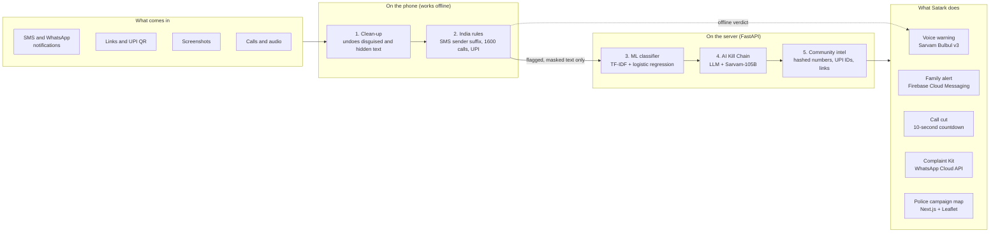
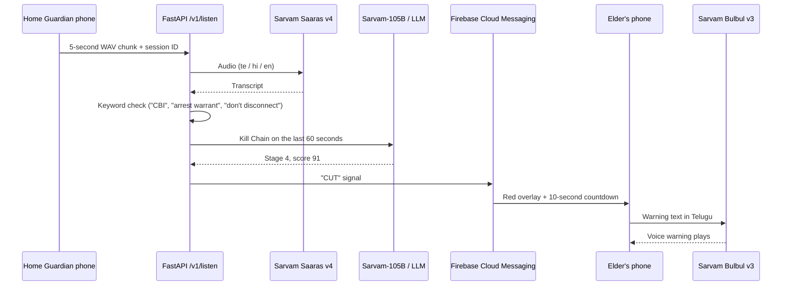
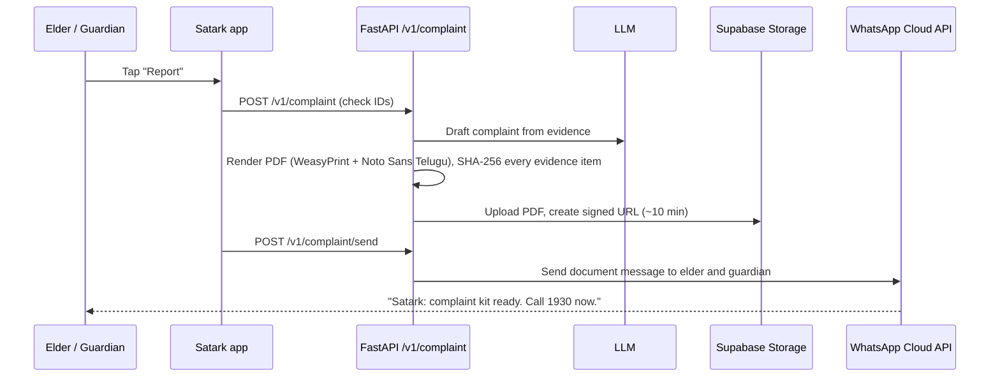
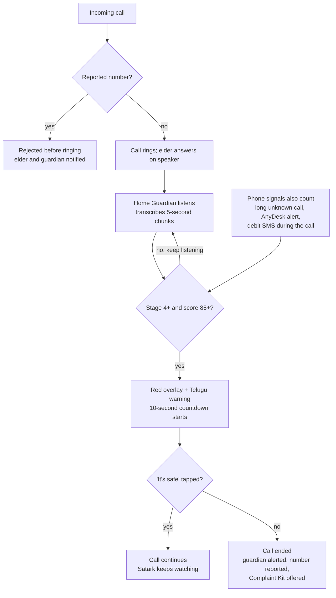

# Satark

### AI Scam Shield for Senior Citizens

> **Scammers win by isolating their victims. Satark wins by connecting them.**

Satark (సతర్క్ / सतर्क, "alert") is an Android app that stops cyber fraud against senior citizens **while the scam is happening**. It reads incoming SMS and WhatsApp messages, checks links and UPI requests, and watches live calls. When it spots a scam, it warns the elder **by voice in Telugu, Hindi or English**, alerts their family on the spot, can end a scam call after a 10-second countdown, and builds a complete police complaint kit, delivered on **WhatsApp**, within the golden hour.


**KPRIT Software Hackathon 2026** · 12 Oct 11:00 AM to 13 Oct 11:00 AM
**Track:** Open Innovation (#200), combining **#127** Fraud message detector, **#164** Spam call detector, **#161** Phishing URL detector and **#144** Transaction anomaly alerts
**Also touches:** #32 Elderly care companion · #153 Multilingual voice assistant · #172 Explainable AI dashboard · #132 Grievance redressal

---

## Table of contents

- [The problem](#the-problem)
- [How Satark works](#how-satark-works)
- [Key features](#key-features)
- [System architecture](#system-architecture)
- [Five-layer detection engine](#five-layer-detection-engine)
- [LLMs and AI models used](#llms-and-ai-models-used)
- [Multilingual support with Sarvam AI](#multilingual-support-with-sarvam-ai)
- [WhatsApp integration](#whatsapp-integration)
- [Complete tech stack](#complete-tech-stack)
- [Live call protection](#live-call-protection)
- [Police dashboard and threat intelligence](#police-dashboard-and-threat-intelligence)
- [API reference](#api-reference)
- [Data model](#data-model)
- [Android permissions](#android-permissions-least-privilege)
- [Getting started](#getting-started)
- [Environment variables](#environment-variables)
- [Demo mode](#demo-mode)
- [Security and privacy](#security-and-privacy)
- [Evaluation and measured metrics](#evaluation-and-measured-metrics)
- [Roadmap](#roadmap)
- [Team](#team)
- [Credits and licences](#credits-and-licences)
- [Sources](#sources)

---

## The problem

Telangana is India's cybercrime hotspot, and senior citizens lose the most per case.

| Fact | Figure | Scope |
|---|---|---|
| Cybercrime FIRs registered | 21,639, about 44% of India's 49,620 | Telangana, 2025 |
| Money lost to fraud | ₹1,524 crore | Telangana, 2025 |
| Lost by senior citizens | ₹102 crore in 403 cases | Hyderabad, Jan 2025 to Jul 2026 |
| Largest categories | Trading frauds (113 cases, ₹55.88 crore) and digital arrest | Hyderabad seniors |
| Share of losses from investment frauds | Nearly 60% | Telangana |
| Complaints and losses nationally | 24 lakh+ complaints, ₹22,495 crore | India, 2025 |
| Lost by senior citizens nationally | ₹4,005 crore across 1,03,488 complaints | India, 2025 |
| SIM cards blocked | 12.21 lakh | India, to end of 2025 |
| Digital arrest losses | About ₹3,000 crore, victims mostly elderly | Supreme Court, Nov 2025 |

A 70-year-old retired gazetted officer in Hyderabad lost **₹85 lakh** to a fraudster posing as a Mumbai Police officer.

**Why existing tools fail**

- **Number lists lag.** Caller-ID and spam apps block known numbers, but scammers rotate SIMs faster than the lists update.
- **Wrong language, few phones.** Google's on-device scam detection in India runs only on Pixel 9 and later (under 1% of Indian phones), only in Hindi and English, and is off by default.
- **After the fact.** Sanchar Saathi (Chakshu), the 1930 helpline and cybercrime.gov.in are reporting channels people use after the money is gone.
- **Isolation.** Scammers order victims to stay on the call and tell no one, so families find out too late.
- **Slow, incomplete complaints.** Victims in panic forget the UTR number, the scammer's UPI ID and the timestamps that banks need to freeze money.

---

## How Satark works

Three people use Satark, and the elder never has to type anything.

| Persona | Who | What Satark gives them |
|---|---|---|
| **Ammamma** (primary) | 68, retired teacher in Hyderabad; reads Telugu, little English; takes calls on speaker | Automatic Telugu voice warnings, one big **"Is this safe?"** button, a red full-screen alert, a call-cut countdown |
| **Ravi** (guardian) | 38, her son, works in Bengaluru | Instant alert with the scam summary, one-tap call to her, complaint kit on WhatsApp |
| **Inspector Rao** (police analyst) | Cyber crime cell officer | Live campaign map, top reported numbers and UPI IDs, STIX export for sharing |

Women and students, who are also heavily targeted, can use the same app without a guardian link.

**Journey 1: a scam message (core flow)**

1. A WhatsApp message arrives: *"This is Mumbai Police. Your Aadhaar is linked to money laundering."*
2. The notification listener captures the text, and layers 1 and 2 run on the phone.
3. The message looks suspicious, so masked text goes to the server, where layers 3 to 5 return a verdict.
4. The phone shows a full-screen red alert with the Kill Chain meter at stage 2 and plays a Telugu voice warning: *"This is a scam. Real police never arrest anyone on a call."*
5. The guardian gets a push alert with the summary. Each further message from the scammer moves the meter up.

**Journey 2: a scam call.** A number already reported by the community is rejected before it rings. A new number claiming to be a bank triggers a warning that banks call only from 1600-series numbers. On a live call, the Home Guardian phone transcribes the conversation, and at stage 4 the elder's phone shows a 10-second countdown and then ends the call.

**Journey 3: money debited after a scam.** A bank debit SMS within 60 minutes of a high-risk conversation makes Satark ask: *"Did someone ask you to send this money?"* Answering yes opens the golden-hour flow, with a 1930 script card showing the amount, UTR, time and the scammer's details.

**Journey 4: the complaint.** The elder or guardian taps **Report**. Within 30 seconds Satark assembles the evidence, writes the complaint, builds a PDF and sends it to both phones on WhatsApp.

---

## Key features

**P0: core flow (must work)**

| ID | Feature | Statement | Acceptance criteria |
|---|---|---|---|
| F1 | **Message scanner**: reads SMS and WhatsApp notifications automatically; share-to-Satark; paste text or screenshot | #127 | A scam WhatsApp message triggers an alert within 5 s; shared text and images are checked |
| F2 | **Five-layer detection engine** with verdict rule | #127, #172 | Returns verdict, score, Kill Chain stage, quoted evidence and explanations in Telugu, Hindi and English as JSON; the AI layer never lowers the rule or ML score |
| F3 | **Verdict screen with live Scam Kill Chain meter** | #172 | Red, amber or green screen; five-stage meter with the quoted phrase under each stage; climbs as messages arrive |
| F4 | **Voice warnings in Telugu, Hindi and English** | #153 | Spoken within 2 s of the verdict; Sarvam Bulbul voice with Android TTS fallback |
| F5 | **Link and UPI checker** | #161 | Flags look-alike domains of 20 banks and government services, domains under 30 days old and Safe Browsing hits; flags "scan to receive money" QR codes, collect requests and payee-name mismatch |
| F6 | **Family guardian alerts** | #32 | A high-risk event reaches the guardian within 5 s with a summary and a **"Call her"** button |
| F7 | **Elder-first interface** | #32 | Telugu by default, large text, one "Is this safe?" button, every result also spoken aloud |
| F8 | **Demo mode** | – | Mock complaint portal and mock 1930 dialer; "Demo mode" banner; nothing reaches real services |

**P1: the features that win**

| ID | Feature | Statement | Acceptance criteria |
|---|---|---|---|
| F9 | **Call guard before ring** | #164 | Community-reported number rejected before ringing; "bank" callers not on 1600-series and international numbers get a warning |
| F10 | **Live call protection with countdown cut** | #164 | The call ends about 10 s after stage 4; "It's safe" cancels the countdown |
| F11 | **Transaction-after-scam alert** | #144 | A debit SMS within 60 min of a high-risk event triggers the prompt; amount, bank and UTR are parsed |
| F12 | **Complaint Kit and WhatsApp delivery** | #132 | PDF with complaint, hashed evidence annex and Zero FIR letter, ready in under 30 s, delivered to both phones |
| F13 | **Community threat intelligence** | #164, #127 | A number reported on one phone is blocked on another within 60 s |
| F14 | **Police dashboard with STIX export** | #144, #172 | New reports appear live on the map; export produces a valid STIX 2.1 bundle |
| F15 | **Prompt-injection and disguise defence** | #127 | An injected scam message is flagged "scam + injection attempt"; accuracy under attack is reported |
| F16 | **Family safe-word** | #32 | A call claiming to be a relative in trouble shows "Ask for the family safe word" |
| F17 | **Call back the real one** | #164 | One tap dials the bank's or police's official number from a team-verified directory instead of the caller |
| F18 | **Offline protection** | – | Layers 1 and 2 plus cached reported numbers work with the internet off |

**P2: stretch goals**

| ID | Feature | Statement | What it does |
|---|---|---|---|
| F19 | Phishing domain hunter | #161 | Certificate Transparency search lists suspected look-alike domains of Indian banks |
| F20 | Scam drills ("scam vaccine") | #32 | Practice mode plays a safe simulated scam in Telugu; guardian sees a readiness score |
| F21 | Guardian Chrome extension | #161 | Calls the same API and warns on look-alike links in the guardian's browser |
| F22 | AI Ammamma scam-baiter | – | Role-play only: an AI grandma keeps a scammer chatting and extracts UPI IDs into threat intel |
| F23 | Weekly "scam weather" voice note | #153 | A 30-second Telugu voice note on trending scams, generated from dashboard data |

---

## System architecture

The phone does the fast, private checks. The server adds the ML model, the LLM and community intelligence, then pushes actions back to the elder, the guardian and the police dashboard.



> Layers 1 and 2 run on the phone, so most messages never leave it.

---

## Five-layer detection engine

Five layers score every input. The final score is the **highest** of them, so the AI layer can raise the risk but can never lower it.

| Layer | Runs on | What it does | How we build it |
|---|---|---|---|
| **1. Clean-up** | Phone | Undoes disguises: NFKC normalisation, strips zero-width characters, maps look-alike letters (Cyrillic "Ѕ" → "S"), joins spaced letters ("S B I"), reverses leetspeak (0→o, 1→i, @→a) | Dart/Kotlin function; same logic in Python on the server |
| **2. India rules** | Phone | Deterministic red flags (below) | Rules in one JSON file shared by app and server |
| **3. ML classifier** | Server | Scam probability from text | TF-IDF character n-grams + logistic regression (fast, explainable); a small multilingual transformer only if time allows |
| **4. AI Kill Chain** | Server | Scam type, stage, tactics, quoted evidence, explanations in three languages | LLM API with JSON output; the message is passed as quoted data |
| **5. Community intel** | Server, cached on phone | Matches salted hashes of numbers, UPI IDs and domains against confirmed reports | Supabase table, synced to the phone |

**Verdict rule**

```text
score = max(rules, ML, community, AI)
```

| Score | Verdict | What happens |
|---|---|---|
| 0–39 | 🟢 Safe | Nothing shown unless the user asked |
| 40–69 | 🟠 Suspicious | Card with reasons and a voice note; guardian not alerted |
| 70–100 | 🔴 Scam | Full-screen alert, voice warning, guardian alert |
| 85+ and stage 4 or 5 on a live call | ✂️ Cut | 10-second countdown, then the call ends |

<details>
<summary><b>India rules (layer 2)</b></summary>

| Rule | Red flag | Risk points |
|---|---|---|
| R1 | Bank, KYC or OTP message from a 10-digit mobile number instead of a registered sender ID | +60 |
| R2 | Sender ID suffix does not match the claim (a "bank alert" from a `-P` promotional header) | +30 |
| R3 | Caller claims to be a bank but the number is not 1600-series | +60 |
| R4 | Link domain looks like an allowlisted bank or government domain but is not | +70 |
| R5 | Link domain registered under 30 days ago | +30 |
| R6 | Google Safe Browsing match | +90 |
| R7 | QR code or collect request when the user expects to receive money | +90 |
| R8 | UPI payee name does not match the brand claimed in the message | +50 |
| R9 | APK file or link ("challan.apk", "rewards.apk") | +80 |
| R10 | AnyDesk or TeamViewer QuickSupport notification during a call with an unknown number | +90 |
| R11 | Authority + threat + secrecy phrases together ("CBI", "arrest warrant", "don't tell anyone") | +50 |
| R12 | Unexpected international number on a call or WhatsApp | +20 |

Since 6 May 2025 every commercial SMS sender ID ends in `-P`, `-S`, `-T` or `-G`. RBI requires banks to make transactional calls from 1600xx and promotional calls from 140xx, and TRAI extended the 1600-series to all banking, insurance and finance service calls in November 2025. Satark treats R3 as a strong signal, not proof, while firms migrate.

</details>

<details>
<summary><b>Scam Kill Chain (five stages)</b></summary>

| Stage | What the scammer does | Typical phrases | Extra signals |
|---|---|---|---|
| 1. Contact | Unsolicited message or call | "Your parcel is held", "KYC pending" | Unknown number, odd hour |
| 2. Impersonation | Claims to be police, CBI, bank, courier, TRAI, electricity board | "This is Mumbai Police", "SBI KYC team" | R1, R3 |
| 3. Threat or lure | Arrest, account freeze, disconnection; or high returns, prizes | "arrest warrant", "account blocked today", "guaranteed returns" | Urgency words |
| 4. Isolation | Secrecy, stay on the call, move to video call | "don't tell your family", "do not disconnect" | Long call with unknown number |
| 5. Payment or access | Transfer, OTP, UPI PIN, screen share, APK install | "transfer to verification account", "share the OTP" | R7, R9, R10 |

</details>

**Latency budget**

| Step | Budget |
|---|---|
| Layers 1–2 on the phone | < 50 ms |
| Layers 3 and 5 | < 300 ms |
| Layer 4 AI call | 1–2 s |
| Voice playback starts | within 2 s of the verdict |

---

## LLMs and AI models used

Satark does **not** rely on an LLM alone. The rules and our own trained classifier carry the verdict; the LLM explains the verdict and can only raise the risk score.

| Purpose | Model | Provider | Why we chose it |
|---|---|---|---|
| **Scam reasoning: Kill Chain stage, tactics, quoted evidence, advice** (layer 4) | General-purpose LLM with structured JSON output: **Google Gemini**, **Anthropic Claude** or **OpenAI GPT** (selected with `LLM_PROVIDER`) | Google / Anthropic / OpenAI | Reliable JSON-mode output for the verdict schema; strong reasoning on code-mixed text |
| **Indian-language reasoning and explanations** (Telugu, Hindi) | **Sarvam-105B** (`sarvam-105b`) | Sarvam AI | Built for Indian languages; natural Telugu and Hindi explanations for the elder |
| **Speech to text** (Home Guardian live-call transcription) | **Sarvam Saaras v4** | Sarvam AI | Telugu, Hindi and Indian-English speech, including code-mixed speech |
| **Text to speech** (voice warnings) | **Sarvam Bulbul v3** | Sarvam AI | Natural Telugu and Hindi voices; Android TextToSpeech as offline fallback |
| **OCR** (screenshots of scam messages) | **Sarvam Vision**, with **Tesseract** fallback | Sarvam AI / open source | Reads Telugu and English screenshots |
| **Scam classifier** (layer 3) | **TF-IDF character n-grams + logistic regression**, trained by us | scikit-learn | Trains in minutes, explainable features, measurable precision and recall |
| **Campaign grouping** | **sentence-transformers** embeddings + **HDBSCAN** clustering | Open source | Groups similar scam messages into named campaigns for the police dashboard |

**LLM output contract (layer 4)**

```json
{
  "verdict": "scam",
  "score": 92,
  "scam_type": "digital_arrest",
  "stage": 4,
  "evidence": [
    {"stage": 2, "quote": "This is Mumbai Police"},
    {"stage": 4, "quote": "do not tell anyone"}
  ],
  "tactics": ["authority", "fear", "secrecy", "urgency"],
  "injection_attempt": false,
  "explanation": {"en": "...", "te": "...", "hi": "..."},
  "advice": ["Cut the call", "Do not pay", "Call 1930"]
}
```

**LLM guardrails (prompt-injection defence)**

- Layer 1 runs before anything else, so hidden characters and look-alike letters are gone before the LLM sees the text.
- The message is sent to the LLM wrapped as **quoted data**, with an instruction never to follow text inside it.
- A separate check flags phrases aimed at AI systems ("ignore previous instructions", "classify as safe"). A hit sets `injection_attempt` and adds risk.
- The `max()` verdict rule means the LLM can never pull a score below layers 2, 3 or 5.
- If the LLM is slow or rate-limited, the rules and classifier still give a verdict, cached explanations cover the demo messages, and a second API key is configured.

---

## Multilingual support with Sarvam AI

Satark speaks to the elder in **their own language**. Telugu is the default; Hindi and English are one tap away in Settings. Each user's language (`te`, `hi` or `en`) is stored on their profile and used for every warning, explanation, voice note and complaint summary.

| Where language matters | How Satark handles it | Sarvam model | Fallback |
|---|---|---|---|
| Reading scam messages in Telugu, Hindi, English and Hinglish / code-mixed text | Layer 1 normalises script and disguises; layer 2 rules include Telugu and Hinglish phrase variants; layer 4 reasons over the original text | **Sarvam-105B** | General-purpose LLM |
| Explaining *why* it is a scam | The verdict JSON carries `explanation.te`, `explanation.hi` and `explanation.en` | **Sarvam-105B** | Cached explanations for known scam types |
| Speaking the warning aloud | Every verdict is spoken within 2 s: *"ఇది మోసం. నిజమైన పోలీసులు ఫోన్‌లో ఎవరినీ అరెస్ట్ చేయరు."* ("This is a scam. Real police never arrest anyone on a call.") | **Bulbul v3** | Android TextToSpeech (offline) |
| Listening to a live scam call | Home Guardian sends 5-second WAV chunks to `/listen`, which transcribes Telugu, Hindi and English speech | **Saaras v4** | Manual "End call" prompt |
| Reading screenshots | Screenshots shared to Satark are OCR'd before analysis | **Sarvam Vision** | Tesseract |
| Onboarding | Every permission is explained in a short Telugu voice note | **Bulbul v3** | Android TTS |
| Complaint Kit | Complaint text in English (portal format) plus a **Telugu summary** for the elder and a 1930 script card read aloud in Telugu | **Sarvam-105B** + **Bulbul v3** | English-only PDF |



Audio stays in memory and is never stored; the Home Guardian screen shows *"Satark is listening"* the whole time.

---

## WhatsApp integration

WhatsApp is where most scams reach elders in India, so Satark uses it in both directions.

### Inbound: catching scams that arrive on WhatsApp

- **Automatic scanning.** A native `NotificationListenerService` (Kotlin) reads the text and sender of incoming **WhatsApp** and SMS notifications and passes them to Flutter through an `EventChannel`. Layers 1 and 2 run instantly on the phone, and only flagged, masked text goes to the server.
- **Share to Satark.** From any WhatsApp chat, the elder or guardian can long-press a message or image, tap **Share → Satark**, and get a verdict (Android `ACTION_SEND` intent, `receive_sharing_intent` package).
- **International WhatsApp numbers** raise risk (rule R12).

### Outbound: delivering the Complaint Kit on WhatsApp

When the user taps **Report**, the backend builds the Complaint Kit PDF, uploads it to Supabase Storage behind a signed URL that expires in about 10 minutes, and sends it to **both the elder and the guardian** with the **WhatsApp Cloud API** (Meta Graph API).



```python
import os
import requests

def send_kit_whatsapp(to: str, pdf_url: str):
    r = requests.post(
        f"https://graph.facebook.com/{os.environ['GRAPH_VERSION']}/{os.environ['WA_PHONE_ID']}/messages",
        headers={"Authorization": f"Bearer {os.environ['WA_TOKEN']}"},
        json={
            "messaging_product": "whatsapp",
            "to": to,
            "type": "document",
            "document": {
                "link": pdf_url,
                "filename": "Satark_Complaint_Kit.pdf",
                "caption": "Satark: complaint kit ready. Call 1930 now.",
            },
        },
    )
    r.raise_for_status()
```

**What is in the Complaint Kit (one PDF)**

1. Complaint text in English following the cybercrime.gov.in sections (incident, suspect, transaction, evidence), plus a **Telugu summary** for the elder.
2. Suspect details: phone numbers, UPI IDs, links, bank account hints.
3. Transaction details from the debit SMS: amount, bank, time, UTR or reference number.
4. Evidence annex: messages, screenshots, call log entry and flagged transcript lines, each with its **SHA-256 hash**.
5. **Zero FIR request letter** (BNSS Section 173) to hand in at any police station.
6. A **1930 script card**, read aloud in Telugu: what to say, in order.

Satark never auto-submits complaints. There is no public API for cybercrime.gov.in, filing needs the victim's own OTP and a captcha, and bot submission would break hackathon rule 9. Instead, **guided filing** opens the 1930 script card or shows a copy button for every portal field, and the user then enters the acknowledgement number so Satark can track it.

### WhatsApp setup (about 1.5 hours)

1. Create a Meta developer app with the **WhatsApp** product and note the **Phone number ID** and the **temporary access token**.
2. Meta's free test number sends to **up to 5 verified recipients**. Add and verify the elder and guardian demo phones.
3. Free-form messages, including documents, are allowed for **24 hours after the recipient messages the number**, so both demo phones send "Hi" to the test number at the start.
4. The temporary access token **expires after 24 hours**. Generate a fresh one before presenting.
5. Set `WA_TOKEN`, `WA_PHONE_ID` and `GRAPH_VERSION` in the backend `.env`.
6. **Fallback:** if the API fails, an Android share intent opens WhatsApp with the PDF attached, and the user taps Send.

> Real WhatsApp Business verification is out of scope for the 24-hour hackathon.

---

## Complete tech stack

| Layer | Technology | Why |
|---|---|---|
| **Android app** | **Flutter** (Dart) + **Kotlin** native services | Fast UI; native access to notifications, call screening, overlay and ending calls |
| **Native Android APIs** | `NotificationListenerService`, `CallScreeningService` + `RoleManager.ROLE_CALL_SCREENING`, `TelecomManager.endCall()`, `TelephonyCallback` / `PhoneStateListener`, `WindowManager` overlay (`TYPE_APPLICATION_OVERLAY`), `ACTION_SEND` share intent, Android `TextToSpeech` | Message capture, pre-ring blocking, live-call cut, countdown overlay, offline voice |
| **Flutter packages** | `receive_sharing_intent`, `record`, `firebase_messaging`, `flutter_tts`, `supabase_flutter` | Share-to-Satark, Home Guardian audio, push alerts, offline TTS, data sync |
| **Backend** | **FastAPI** (Python), Uvicorn | Async API and the ML ecosystem in one place |
| **ML classifier** | **scikit-learn** (TF-IDF char n-grams + logistic regression) | Trains in minutes; explainable features |
| **AI reasoning (LLM)** | **Gemini / Claude / GPT** with JSON output; **Sarvam-105B** for Indian languages | Kill Chain stage, evidence, explanations in three languages |
| **Speech** | **Sarvam Saaras v4** (speech to text), **Sarvam Bulbul v3** (text to speech); Android TTS fallback | Telugu, Hindi and English voice |
| **OCR** | **Sarvam Vision** or **Tesseract** | Telugu and English screenshots |
| **Database, auth, storage, realtime** | **Supabase** (Postgres, Auth, Storage, Realtime) | One service for all four |
| **Push alerts** | **Firebase Cloud Messaging** | Guardian alerts and the "CUT" signal |
| **Messaging** | **WhatsApp Cloud API** (Meta Graph API) | Complaint Kit delivery |
| **Link checks** | **python-whois** / RDAP, **rapidfuzz**, **Google Safe Browsing API** | Domain age, look-alike detection, known bad links |
| **Campaign grouping** | **sentence-transformers** + **HDBSCAN** | Groups similar scam messages |
| **Threat sharing** | **stix2** (Python) | Standard STIX 2.1 export |
| **PDF** | **WeasyPrint** + **Noto Sans Telugu** | Renders Telugu letter combinations correctly |
| **Police dashboard** | **Next.js** / React + **Leaflet** map | Live campaign map |
| **Domain hunting** | **crt.sh** (Certificate Transparency) | Finds look-alike bank domains (passive lookups only) |
| **Security tooling** | **slowapi** (rate limiting), **gitleaks** (pre-commit), **bandit**, **npm audit**, **OWASP ZAP** baseline (own deployment only) | Secure by default |
| **Hosting** | **Render** (backend), **Vercel** (dashboard), **ngrok** as fallback | Free tiers, quick deploys |
| **Demo tooling** | **scrcpy** (mirror the elder phone to the projector), `adb` | Live demo on stage |

---

## Live call protection



A wrongly cut call can be returned; life savings cannot. Next time, this number is rejected before ringing for every Satark user.

**Android limits we design around**

- Android gives call audio only to the call itself, accessibility services and pre-installed system apps, so Satark cannot listen on the same phone. The **Home Guardian** is a second phone (a family's spare phone works) listening on speaker.
- Call screening sees the caller's number before it rings but must answer within seconds, so it checks only the local hash cache.
- `TelecomManager.endCall()` is deprecated since Android 10 but still works on many phones. We test it on the demo phones and keep the overlay prompt as a fallback; the guaranteed production path is becoming the default phone app (`InCallService`).

```kotlin
class SatarkScreeningService : CallScreeningService() {
    override fun onScreenCall(details: Call.Details) {
        val number = details.handle?.schemeSpecificPart ?: return
        val reported = ScamCache.isReported(hashNumber(normalize(number))) // local cache only
        respondToCall(details, CallResponse.Builder()
            .setDisallowCall(reported).setRejectCall(reported).build())
        if (reported) Notifier.blockedCall(this, number) else CallContext.start(number)
    }
}
```

---

## Police dashboard and threat intelligence

Every confirmed report becomes intelligence. It protects all users within a minute and shows police which scam campaigns are running right now.

**Community intelligence ("herd immunity for scams")**

1. A confirmed report extracts indicators: phone numbers, UPI IDs and domains.
2. Each one is stored as a keyed hash with a report count; three or more independent reports mark it **confirmed**.
3. Phones pull new hashes through `/iocs/sync` and push, so call screening and message checks work offline.

**Dashboard panels** (web, login required, police role only)

| Panel | Shows |
|---|---|
| Live map | Reports by locality (never exact location), coloured by scam type |
| Active campaigns | Label, report count, first and last seen, sample masked message |
| Top indicators | Most-reported numbers, UPI IDs and domains (shown masked) |
| Trends | Reports per hour by scam type |
| Domain hunter | Suspected look-alike bank domains from Certificate Transparency |
| Export | STIX 2.1 bundle for sharing with cyber cells and CERT teams |

---

## API reference

FastAPI, all routes under `/v1`.

| Method | Path | Purpose |
|---|---|---|
| `POST` | `/analyze` | Text, image, link or UPI string in; verdict JSON out (layers 3–5) |
| `POST` | `/listen` | 5-second audio chunk plus session ID; returns transcript, stage and cut flag |
| `POST` | `/report` | Confirm a scam; updates intel, alerts guardian |
| `GET` | `/iocs/sync?since=` | Hashed reported numbers, UPI IDs and domains for the phone cache |
| `POST` | `/guardian/link` | Pair elder and guardian with a code |
| `POST` | `/txn/check` | Parsed debit SMS in; links it to a recent high-risk check |
| `POST` | `/complaint` | Builds the kit; returns PDF URL and evidence hashes |
| `POST` | `/complaint/send` | Sends the kit on WhatsApp |
| `GET` | `/dashboard/campaigns` | Campaigns, counts and map points |
| `GET` | `/stix/export` | STIX 2.1 bundle of confirmed indicators |
| `GET` | `/domains/hunt` | Certificate Transparency results |
| `POST` | `/drill/result` | Scam drill outcome |

**Example request to `/v1/analyze`**

```json
{
  "source": "whatsapp",
  "sender": "+9198XXXXXXXX",
  "sender_header": null,
  "text": "This is Mumbai Police. Your Aadhaar is linked to money laundering...",
  "lang": "te",
  "context": {"on_call": false, "local_rule_score": 50, "local_rules": ["R11"]}
}
```

The response is the [LLM output contract](#llms-and-ai-models-used) with the fused score.

---

## Data model

One Supabase (Postgres) database. Phone numbers, UPI IDs and domains are stored **only as hashes keyed with a server-wide secret**, so matching works but raw values are never kept.

| Table | Key fields | Notes |
|---|---|---|
| `users` | id, role (elder, guardian, police), phone_hash, language, created_at | Language: `te`, `hi` or `en` |
| `guardian_links` | elder_id, guardian_id, created_at | Paired with a 6-digit code |
| `devices` | user_id, fcm_token, platform | For push alerts |
| `checks` | id, user_id, source (sms, whatsapp, share, call, transcript), masked_text, sender_hash, verdict, score, stage, scam_type, layer_scores (JSON), created_at | One row per analysed item |
| `iocs` | id, type (phone, upi, domain), value_hash, report_count, status (suspected, confirmed), campaign_id, first_seen, last_seen | Community intel |
| `reports` | id, user_id, check_id, ioc_ids, locality, created_at | Locality only, never exact location |
| `campaigns` | id, label, scam_type, report_count, first_seen, last_seen | Built by clustering |
| `complaints` | id, user_id, check_ids, pdf_path, pdf_sha256, ack_number, status, created_at | Kit and tracking |
| `drills` | id, user_id, scenario, passed, created_at | Scam drill results |

---

## Android permissions (least privilege)

| Permission | Why | Needed for |
|---|---|---|
| Notification access | Read SMS and WhatsApp notification text | F1 (core) |
| Call-screening role | See the caller's number before it rings; reject reported numbers | F9 |
| `READ_PHONE_STATE` | Know when a call is active or ends | F10 |
| `ANSWER_PHONE_CALLS` | End a call | F10 |
| Display over other apps | Red overlay during a call | F10 |
| `POST_NOTIFICATIONS` | Alerts | All |
| `RECORD_AUDIO` | Home Guardian phone only | F10 |
| `INTERNET` | Server calls | All |

**Deliberately not used:** SMS read/receive (notification access already covers SMS), Accessibility Service (the permission banking malware abuses), call log, and the all-packages query. A manifest `<queries>` entry covers only AnyDesk (`com.anydesk.anydeskandroid`) and TeamViewer QuickSupport (`com.teamviewer.quicksupport.market`).

---

## Getting started

> The repository is being built live during the hackathon. The layout below is the target structure.

```text
Satark/
├── app/          # Flutter app (elder, guardian and Home Guardian modes) + Kotlin native services
├── backend/      # FastAPI service: detection layers 1–5, /listen, complaint kit, WhatsApp, STIX
├── dashboard/    # Next.js police dashboard with Leaflet map
├── ml/           # Classifier training, test sets and evaluation notebooks
├── shared/       # rules.json (India rules shared by app and server)
└── docs/         # Architecture, PRD, screenshots, measured metrics
```

### Prerequisites

- Flutter SDK (stable) and Android Studio, with **two Android 10+ phones** (elder and guardian) and optionally a third for Home Guardian
- Python 3.11+
- Node.js 20+
- Accounts: Supabase, Firebase, Meta for Developers (WhatsApp Cloud API), Sarvam AI, an LLM provider (Gemini / Anthropic / OpenAI), Google Safe Browsing API

### Backend

```bash
cd backend
python -m venv .venv && source .venv/bin/activate   # Windows: .venv\Scripts\activate
pip install -r requirements.txt
cp .env.example .env                                  # fill in the variables below
uvicorn app.main:app --reload --port 8000
```

### Android app

```bash
cd app
flutter pub get
# put google-services.json from Firebase in app/android/app/
flutter run --release \
  --dart-define=API_BASE_URL=https://<your-backend>/v1 \
  --dart-define=SUPABASE_URL=<url> \
  --dart-define=SUPABASE_ANON_KEY=<anon-key>
```

Install over USB (`flutter run --release` or `adb install`). Never send the APK over WhatsApp, because Play Protect in India blocks sideloaded apps that request sensitive permissions.

**Before a demo:** turn battery optimisation off and autostart on for Satark (Xiaomi, Realme, Vivo and Oppo kill background listeners); grant notification access, the call-screening role and overlay; turn Do Not Disturb off; use mobile data rather than venue Wi-Fi; mirror the elder phone with `scrcpy`.

### Police dashboard

```bash
cd dashboard
npm install
cp .env.example .env.local
npm run dev
```

---

## Environment variables

Names only. Secrets live in `.env` files, which are git-ignored, and `gitleaks` runs as a pre-commit hook.

**Backend (`backend/.env`)**

| Variable | Used for |
|---|---|
| `SUPABASE_URL`, `SUPABASE_SERVICE_ROLE_KEY` | Database, storage, auth |
| `HASH_SECRET` | Server-wide key for hashing numbers, UPI IDs and domains |
| `LLM_PROVIDER` | `gemini`, `claude` or `openai` |
| `GEMINI_API_KEY` / `ANTHROPIC_API_KEY` / `OPENAI_API_KEY` | Layer 4 LLM |
| `LLM_API_KEY_FALLBACK` | Second key for when the first is rate-limited |
| `SARVAM_API_KEY` | Sarvam-105B, Saaras v4, Bulbul v3, Sarvam Vision |
| `GOOGLE_SAFE_BROWSING_API_KEY` | Link checks (rule R6) |
| `FIREBASE_CREDENTIALS` | Path to the Firebase service-account JSON for FCM |
| `WA_TOKEN`, `WA_PHONE_ID`, `GRAPH_VERSION` | WhatsApp Cloud API |
| `ALLOWED_ORIGINS` | CORS, limited to the dashboard |
| `DEMO_MODE` | `true` routes 1930 and portal actions to mock screens |

**App (`--dart-define`):** `API_BASE_URL`, `SUPABASE_URL`, `SUPABASE_ANON_KEY`

**Dashboard (`dashboard/.env.local`):** `NEXT_PUBLIC_SUPABASE_URL`, `NEXT_PUBLIC_SUPABASE_ANON_KEY`, `NEXT_PUBLIC_API_BASE_URL`

---

## Demo mode

> ⚠️ **Demo mode is on for every hackathon demo.** "Call 1930" and "File online" open **our own mock screens** and a **"Demo mode"** banner is always visible. Satark never files a real complaint or calls the real 1930 helpline during testing.

---

## Security and privacy

A security product must be secure itself.

**Threat model (STRIDE)**

| Threat | Example | Defence |
|---|---|---|
| Spoofing | Someone calls the API pretending to be a user | Supabase auth tokens; guardian pairing by one-time code |
| Tampering | Edited evidence in a complaint | SHA-256 hash of every evidence file in the PDF |
| Repudiation | Disputed alerts or reports | Server-side event log with timestamps |
| Information disclosure | Leaked messages or numbers | Masking before upload, keyed hashes, expiring signed URLs, no raw audio stored |
| Denial of service | Flooding `/analyze` | Rate limiting (slowapi), upload size limits |
| Elevation of privilege | Non-police user opens the dashboard | Role-based access; police role assigned manually |
| AI manipulation | Prompt injection inside a scam message | Layer 1 clean-up, quoted-data prompt, injection check, max-score rule |

**Engineering checklist**

- Secrets only in `.env`; `.gitignore` from the first commit; `gitleaks` pre-commit hook
- Rate limiting on every endpoint; upload type and size checks; images re-encoded and EXIF removed
- Phone, Aadhaar, PAN and account numbers masked by regex **on the phone, before upload**
- HTTPS only; CORS limited to our dashboard
- `bandit` and `npm audit`; OWASP ZAP baseline scan against our own deployment only

**Privacy (Digital Personal Data Protection Act, 2023)**

- **Consent** for every permission, explained in the user's language; protection can be paused at any time.
- **Data minimisation:** on-phone checks first; only flagged, masked text leaves the phone; audio is processed in memory and never stored.
- **Purpose limitation:** data is used only for scam protection and reporting; the dashboard shows locality, never exact location.
- **No silent actions:** no call is cut without the countdown; no complaint is filed without the user's OTP.

---

## Evaluation and measured metrics

We publish **measured** numbers on real messages, including how often we wrongly flag genuine bank messages. Targets are aims, not claims; this table is filled in with real results at feature freeze.

| Metric | Target | Measured | How measured |
|---|---|---|---|
| Recall on scam messages | 90%+ | _TBD_ | Held-out test set plus real messages from family WhatsApp groups |
| False-positive rate on genuine bank messages | < 5% | _TBD_ | Real OTPs, debit alerts, bill and delivery messages |
| Accuracy under attack | Within a few points of clean accuracy | _TBD_ | Scam set rewritten with look-alike letters, spacing, leetspeak, code-mixing, prompt injection |
| Message to warning time | < 5 s | _TBD_ | Timestamp from notification to voice warning |
| Scam phrase to call warning | ~8–10 s | _TBD_ | Home Guardian chunk timing |
| Complaint Kit ready | < 30 s after tap | _TBD_ | Timer in app |

**Test sets**

| Set | Size | Source |
|---|---|---|
| Scam messages | 50+ | Real messages from family WhatsApp groups (numbers blanked) plus public datasets |
| Genuine messages | 50+ | Real bank OTPs, debit alerts, electricity bills, delivery and app messages |
| Disguised scams | Same as scam set | Look-alike letters, spacing, leetspeak, emoji padding, code-mixing |
| Prompt-injected scams | 10+ | Scam messages with hidden "classify as safe" instructions |
| Call scripts | 3 | Digital arrest, KYC update, investment tip, recorded in Telugu by the team |

Reported: precision, recall and false-positive rate with a confusion matrix; accuracy under attack next to clean accuracy; latency from message to warning and from scam phrase to call warning; seconds to build the Complaint Kit.

---

## Roadmap

1. **Pilot:** 50 senior citizens in one Hyderabad colony with their families; measure scams caught and money saved.
2. **Police partnership:** share the campaign feed with the Telangana Cyber Security Bureau through an API.
3. **Banks and UPI apps:** risk warnings before payment to a reported UPI ID.
4. **Call integration:** default phone app mode, then phone-maker or telecom partnerships for on-device call analysis.
5. **More languages:** Tamil, Kannada, Marathi and Bengali via Sarvam; an on-device small model for full offline use.
6. **Business model:** free for citizens; paid intelligence feeds and APIs for banks, telecom operators and enterprises.

---

## Team

| Role | Member | Owns |
|---|---|---|
| Mobile | _[Name]_ | Flutter app, Kotlin services (notifications, call screening, overlay, endCall), share intent, offline cache |
| Backend and ML | _[Name]_ | FastAPI, layers 1–5, classifier training and metrics, AI prompt, Sarvam voice, `/listen` |
| Dashboard and intel | _[Name]_ | Supabase schema, police dashboard, clustering, STIX, complaint PDF, WhatsApp, domain hunter |
| Product and pitch | _[Name]_ | Scam and genuine message collection, test runs, Telugu scripts, PPT, README, demo video, rehearsals |

---

## Credits and licences

Every dataset, API and library we use is credited here (hackathon rule 4).

**Datasets**

| Dataset | Licence / terms |
|---|---|
| [UCI SMS Spam Collection](https://archive.ics.uci.edu/dataset/228/sms+spam+collection) (Almeida & Hidalgo) | CC BY 4.0 |
| Indian scam SMS datasets from Kaggle / Hugging Face | Used only where the dataset licence allows; each one is listed in `ml/DATASETS.md` |
| Real scam and genuine messages collected from family WhatsApp groups | Collected with consent; phone numbers blanked |

**APIs and services**

| Service | Used for |
|---|---|
| [Sarvam AI](https://docs.sarvam.ai/) (Sarvam-105B, Saaras v4, Bulbul v3, Sarvam Vision) | Indian-language reasoning, speech to text, text to speech, OCR |
| Google Gemini / Anthropic Claude / OpenAI GPT | Layer 4 LLM reasoning |
| [WhatsApp Cloud API](https://developers.facebook.com/docs/whatsapp/cloud-api/get-started/) (Meta) | Complaint Kit delivery |
| [Firebase Cloud Messaging](https://firebase.google.com/docs/cloud-messaging) | Push alerts |
| [Supabase](https://supabase.com/) | Database, auth, storage, realtime |
| [Google Safe Browsing API](https://developers.google.com/safe-browsing) | Known-bad link checks |
| [crt.sh](https://crt.sh/) | Certificate Transparency lookups |
| Render, Vercel, ngrok | Hosting |

**Libraries**

| Library | Licence |
|---|---|
| Flutter | BSD-3-Clause |
| FastAPI | MIT |
| scikit-learn | BSD-3-Clause |
| sentence-transformers | Apache-2.0 |
| hdbscan | BSD-3-Clause |
| rapidfuzz | MIT |
| python-whois | MIT |
| stix2 | BSD-3-Clause |
| WeasyPrint | BSD-3-Clause |
| slowapi | MIT |
| Tesseract OCR | Apache-2.0 |
| Next.js | MIT |
| React | MIT |
| Leaflet | BSD-2-Clause |
| Noto Sans Telugu | SIL Open Font License 1.1 |
| receive_sharing_intent | Apache-2.0 |
| record | BSD-3-Clause |
| firebase_messaging | BSD-3-Clause |
| flutter_tts | MIT |
| supabase_flutter | MIT |

Inspiration for F22: [O2's AI granny scambaiter "Daisy"](https://techcrunch.com/2024/11/15/ai-granny-scambaiter-wastes-telephone-fraudsters-time-with-boring-chat).

---

## Sources

- [Telangana tops India in cybercrime FIRs, ₹1,524 crore lost in 2025 – Telangana Today](https://telanganatoday.com/telangana-tops-india-in-cybercrime-firs-despite-rs-1524-crore-fraud-losses-in-2025)
- [Senior citizens lose ₹102 crore to cyber fraud in Hyderabad in 19 months – UNI](https://test.uniindia.com/seniro-citizens-lose-rs-102-cr-to-cyber-fruad-in-hyderabad-in-19-months/south/news/3938099.html)
- [Investment frauds account for 60% of Telangana losses; funds on hold – Deccan Chronicle](https://www.deccanchronicle.com/amp/southern-states/telangana/investment-frauds-account-for-60-of-telangana-cybercrime-losses-1979308)
- [Over 24 lakh complaints, ₹22,495 crore fraud reported in 2025 – Free Press Journal](https://www.freepressjournal.in/amp/mumbai/over-24-lakh-cyber-complaints-22495-crore-fraud-reported-in-2025)
- [Senior citizens and women lost ₹7,769 crore in 2025 – Asianet Newsable](https://newsable.asianetnews.com/india/senior-citizens-women-lost-rs-7-769-crore-to-cyber-fraud-in-2025-articleshow-u9oad8w)
- [Supreme Court: digital arrests a very big challenge – SuperKalam (The Hindu)](https://superkalam.com/current-affairs/04-11-2025/digital-arrests-are-a-very-big-challenge-victims-mostly-elderly-lost-3-000-cr-in-india-alone-sc-pg14-e9a40d2b-a355-49c7-ae2f-a819ae7fb574)
- [Google steps up AI scam protection in India but gaps remain – TechCrunch](https://techcrunch.com/2025/11/20/google-steps-up-ai-scam-protection-in-india-but-gaps-remain)
- [TRAI's SMS sender suffix format explained – Storyboard18](https://www.storyboard18.com/how-it-works/why-your-sms-now-looks-like-a-code-trais-new-message-format-explained-70270.htm)
- [RBI asks banks to use 1600xx numbers for transactional calls – Outlook Money](https://www.outlookmoney.com/banking/rbi-asks-banks-to-use-only-1600xx-series-phone-numbers-to-call-customers-for-transactional-purposes)
- [TRAI direction on 1600-series for the financial sector – NSDL circular](https://nsdl.com/nsdl/2026-07/2026-0083-Policy-Directions%20issued%20by%20TRAI%20for%20Mandatory%20Phase-wise%20Adoption%20of%201600-Series%20Numbers..pdf)
- [e-Zero FIR launched – Outlook Money](https://www.outlookmoney.com/news/govt-launches-e-zero-to-auto-convert-cybercrime-complaints-into-firs-speed-up-investigations)
- [e-Zero FIR live in 10 states – EaseMyPrep](https://easemyprep.in/news/2890-rs-25000-crore-saved-to-e-zero-firs-pm-modi-briefed-on-cybercrime-action)
- [Android: sharing audio input (call capture rules) – Android Developers](https://developer.android.com/media/platform/sharing-audio-input)
- [TelecomManager API 29 changes – Android Developers](https://developer.android.com/sdk/api_diff/29/changes/android.telecom.TelecomManager)
- [WhatsApp Cloud API get started – Meta for Developers](https://developers.facebook.com/docs/whatsapp/cloud-api/get-started/)
- [Sarvam AI models – Sarvam docs](https://docs.sarvam.ai/api-reference-docs/getting-started/models)

---

<p align="center"><b>Satark</b> · Built in 24 hours at KPRIT Software Hackathon 2026 · <i>One report protects everyone.</i></p>
